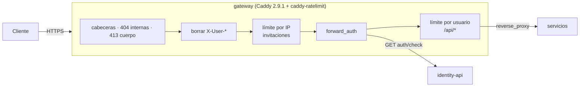

# ADR 0027 — Límites de tasa y de tamaño y cabeceras de seguridad en el gateway (Prototipo 3, escenario 2)

| Campo | Valor |
| :--- | :--- |
| **Estado** | Propuesta |
| **Fecha** | 2026-11-23 |
| **Dominios afectados** | Infraestructura / CI (`gateway/`, `docker-compose.yml`, `bench/`, `.github/workflows/ci-pipeline.yml`) |

## Contexto

El escenario 2 del Prototipo 3 (patrón Reverse Proxy; tácticas Limit exposure, Authenticate actors, Authorize actors y Validate input) parte del gateway Caddy de [ADR 0020](0020-entrada-unica-https-y-topologia-produccion.md). La línea base (`develop` en `5767874`, [evidencia-linea-base.md](../evidencia-linea-base.md)) muestra que:

1. **No hay límite de tasa.** Una ráfaga de 300 req/s durante 15 s se atiende entera: 4500 respuestas 2xx y 0 respuestas 429 (P4). Caddy estándar no trae limitación de tasa.
2. **Las rutas internas responden 401 sin token** (P10), no 404. En Caddy el orden de ejecución lo fija el tipo de directiva y no el orden del texto: `forward_auth` corre antes que `respond`, así que la petición sin token iba a `auth/check` en vez de cortarse en el gateway. La prueba estática que comparaba posiciones en el texto pasaba igual.
3. **No hay límite de tamaño.** El único es el de `express.json()` en identity-api (100 kB), después de que el cuerpo atravesó el gateway.
4. **Las respuestas dicen `Server: Caddy`** (P12) y no llevan cabeceras de seguridad.
5. **`copy_headers` de `forward_auth` (Caddy 2.9.1) no borra las cabeceras que manda el cliente.** Solo escribe las que devuelve identity-api, y `auth/check` no siempre devuelve `X-User-Role`, `X-User-Room-Id` ni `X-User-Nick`. Hoy ningún servicio las lee, pero el límite por usuario necesita una identidad que el cliente no pueda inventar.

Restricción de la medición: el banco (`bench/`) genera toda la carga desde una sola IP, con 20 tokens de host y 20 de invitado, a 200 req/s. Los límites no pueden frenar esa mezcla, o el "después" deja de ser comparable con el "antes".

## Decisión

1. **Imagen propia del gateway.** `gateway/Dockerfile` compila Caddy **2.9.1** con `xcaddy` y `github.com/mholt/caddy-ratelimit` **v0.1.0** (exige Caddy ≥ 2.8). El build falla si `http.handlers.rate_limit` no queda en el binario. `docker-compose.yml` pasa de `image: caddy:2.9-alpine` a `build: ./gateway`; el Caddyfile se sigue montando. El CI construye `tint-gateway:ci` y valida el Caddyfile con ella; `bench/compose.bench.yml` reutiliza la imagen construida como el resto de servicios.
2. **Autenticación y límites dentro de un `route`**, que respeta el orden escrito (`rate_limit` se ordena por defecto antes de `forward_auth`):
   1. `request_header -X-User-Id` (y `-Sub`, `-Role`, `-Room-Id`, `-Nick`): solo identity-api puede poner esas cabeceras.
   2. Zona `per_ip_without_session`: `/api/v1/invitations/*`, clave `{client_ip}`, 600 eventos en 10 s.
   3. `forward_auth @protected` como antes.
   4. Zona `per_user`: `/api/*` con `X-User-Id` presente (solo existe si `forward_auth` validó el token), clave `{http.request.header.X-User-Id}`, 100 eventos en 10 s.
   `/healthz` y `/ws/*` no tienen límite (cada canal ya limita sus mensajes). Sobre el límite: **429** JSON `{"error":"rate_limited",...}` con `Retry-After`.
3. **Rutas internas.** `@internal_api path /api/v1/internal/*` (incluida `auth/check`, que `forward_auth` llama directo al upstream) responde 404, y `/api/v1/internal/*` sale de `@protected`: 404 con y sin token, sin consultar a identity-api.
4. **Límite de cuerpo en `/api/*`.** Un matcher responde **413** JSON si `Content-Length` es de 1 000 000 bytes o más, sin leer el cuerpo; `request_body { max_size 1MB }` corta además los cuerpos `chunked`. `request_body` solo no basta: al enviar el cuerpo al upstream el error sale como 502, no 413.
5. **Cabeceras.** Se quita `Server` y se agregan `X-Content-Type-Options: nosniff`, `X-Frame-Options: DENY`, `Referrer-Policy: strict-origin-when-cross-origin` y una CSP mínima `frame-ancestors 'none'; object-src 'none'; base-uri 'self'`, que no limita scripts ni conexiones (login de Firebase, Google Fonts, MinIO, WebRTC). HSTS queda para el escenario 1 (Secure Channel).
6. **Banco.** La fase `burst` de `bench/k6/api.js` usa un solo token (`data.seeded[0]`): el estímulo es "un cliente". El "antes" no cambia (sin límite, 0 respuestas 429 con uno o con veinte tokens).

**Valores.** En la mezcla del banco a 200 req/s cada token de host hace ~55 peticiones cada 10 s (desviación ~7) y `claim` ~300 cada 10 s desde la IP del portátil: 100 y 600 dejan margen. Una ráfaga de un solo cliente a 300 req/s recibe ~95 % de 429.

## Alternativas consideradas

| Alternativa | Por qué no |
| :--- | :--- |
| Nginx o Traefik, que traen rate limit | Reabre ADR 0020 y pierde los certificados automáticos de Caddy. |
| `caddy add-package` en el contenedor | Descarga el binario en tiempo de ejecución desde un servicio externo: no es reproducible ni queda fijado. |
| `caddy-ratelimit` desde su rama principal | Su `go.mod` exige Caddy 2.10: `xcaddy` subiría Caddy sin avisar. |
| Rate limit en cada servicio (p. ej. `express-rate-limit`) | Repite la lógica en cuatro lenguajes y deja que la carga llegue al servicio; el patrón Reverse Proxy la corta en la entrada. |
| Límite solo por IP | Castiga a muchos usuarios detrás de una misma IP (NAT, campus) y frenaría el banco, que mide desde una IP. |
| Un `order rate_limit after forward_auth` global | Pone todas las zonas en el mismo punto: la zona por IP de rutas sin sesión no necesita esperar a identity-api. |
| CSP completa o en modo *report-only* | La completa exige inventariar todos los orígenes (Firebase, Google, MinIO, WebRTC) y puede romper el login; *report-only* sin `report-uri` no deja evidencia. |

## Consecuencias

**Positivas**
- Un cliente que se pasa del límite recibe 429 y los demás siguen atendidos; las rutas internas dan 404 con y sin token; los cuerpos grandes se rechazan en la entrada.
- La clave del límite por usuario sale de un token verificado y el cliente no puede inyectar `X-User-*`.
- Costo en p95 y CPU: [completar con el "después" del banco; criterio: p95 de la API a 200 req/s menos de 10 % por encima de 13,75 ms].

**Negativas**
- El gateway pasa a ser una imagen propia que hay que construir (`docker compose up -d --build` o `docker compose build gateway`) y una dependencia comunitaria más, fijada en v0.1.0.
- El CI construye la imagen antes de validar el Caddyfile.
- El banco necesita la imagen del gateway construida con la etiqueta del "después".

**Riesgos**
- Límites mal calibrados pueden frenar a usuarios legítimos; los valores están en el Caddyfile y se cambian sin recompilar.
- No hay tope por IP antes de `forward_auth`: una inundación con tokens falsos llega a `auth/check`, y si tienen forma de token de Firebase cada una escribe un `access.denied` en la bitácora (escenario 5). No se agregó porque el banco mide desde una sola IP; queda como límite conocido.
- Si el SSR de la web pasa a entrar por el gateway (escenario 3), `{client_ip}` sería la IP del contenedor `web` hasta configurar `trusted_proxies` con la subred de su red y que el SSR mande `X-Forwarded-For`. *Previsto, no implementado.*
- En producción stream-core sigue publicando 8086/TCP; cerrarlo depende de probar la app Android por el gateway. *Previsto, no implementado.*

## Referencias
- Código: `gateway/Dockerfile`, `gateway/Caddyfile`, `gateway/tests/test_gateway_config.py`, `bench/k6/api.js`, `bench/compose.bench.yml`, `.github/workflows/ci-pipeline.yml`
- Documentos: [pruebas-seguridad.md](../pruebas-seguridad.md), [evidencia-linea-base.md](../evidencia-linea-base.md) (P4, P10–P12), [ADR 0008](0008-subida-directa-a-minio-con-url-firmada.md), [ADR 0020](0020-entrada-unica-https-y-topologia-produccion.md)
- Módulo: [mholt/caddy-ratelimit v0.1.0](https://github.com/mholt/caddy-ratelimit)
