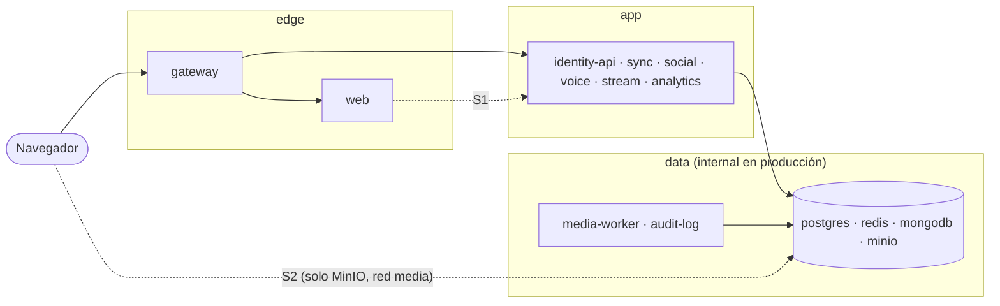

# ADR 0027 — Segmentación de red: una red de Compose por capa

| Campo | Valor |
| :--- | :--- |
| **Estado** | Aceptada |
| **Fecha** | 2026-11-23 |
| **Dominios afectados** | Infraestructura (`docker-compose.yml`, `docker-compose.production.yml`) |

## Contexto
Prototipo 3, escenario 3 (táctica *Separate entities* y *Limit access*, patrón *Network Segmentation*). En `develop` ningún servicio declaraba `networks:`: todos compartían la red `default`, de modo que un contenedor comprometido (por ejemplo `web`) podía abrir conexiones a PostgreSQL, Redis, MongoDB o MinIO. Además se publicaban en todas las interfaces del host los puertos 5432, 6379, 27017, 9000/9001 y 8086. La línea base ([evidencia-linea-base.md](../evidencia-linea-base.md), P13) midió PostgreSQL, Redis, MongoDB y MinIO abiertos desde la LAN.

La [vista en capas](arquitectura.md#7-vista-de-despliegue) ordena el sistema en Presentación → Acceso → Servicios → Datos, con tres saltos de capa conocidos: el SSR de `web` llama a identity-api sin pasar por el gateway (S1), el navegador habla con MinIO con URLs firmadas (S2) y Android usa los servicios directamente (S3).

## Decisión
Una red de Compose por capa; cada servicio entra solo en las redes que necesita.

| Red | Capa | Miembros |
| :--- | :--- | :--- |
| `edge` | Presentación y Acceso | `gateway`, `web`, `firebase-auth-emulator` |
| `app` | Servicios | `gateway`, `web` (salto S1), `identity-api`, `sync-core`, `social-core`, `voice-core`, `stream-core`, `analytics` |
| `data` | Datos | `postgres`, `redis`, `mongodb`, `minio`, `minio-init`, `mongo-init` y los servicios que los usan: `identity-api`, `media-worker`, `analytics`, `audit-log`, `social-core`, `sync-core`, `voice-core`, `stream-core` |
| `media` | Medios | `minio`, `gateway` (URLs firmadas; el escenario 1 añadirá la ruta del gateway) |

- `web`, `gateway` y el emulador **no** están en `data`: no resuelven ni alcanzan a ningún almacén.
- `media-worker` y `audit-log` solo están en `data`: no tienen API ni ruta en el gateway.
- `coturn` sigue en `network_mode: host` (necesita un rango UDP amplio; ADR 0020) y `env-check` usa `network_mode: none`.
- **Desarrollo:** las bases publican en `127.0.0.1` (PostgreSQL, Redis, MongoDB y la consola de MinIO), así que depurar desde el portátil sigue funcionando y la LAN no las ve. `data` no es `internal` porque una red interna no admite puertos publicados.
- **Producción** (`docker-compose.production.yml`): `data` es `internal: true` (PostgreSQL, Redis y MongoDB no tienen salida a Internet; MinIO sí la tiene por `media`), PostgreSQL, Redis y MongoDB no publican nada, MinIO publica solo la API 9000 y stream-core solo su UDP de medios. Con el gateway quedan 80/443, 9000 y el UDP de stream-core, más coturn.
- La prueba `gateway/tests/test_network_segmentation.py` fija estas reglas, incluida la alcanzabilidad (cada llamada legítima conserva una red común) y los puertos efectivos de producción.

## Alternativas consideradas
| Alternativa | Por qué no |
| :--- | :--- |
| `data` `internal: true` también en desarrollo | Los puertos de depuración (`127.0.0.1:5432`, etc.) dejan de funcionar con una red interna y las pruebas de integración dependen de ellos. |
| Quitar los puertos de las bases también en desarrollo | Rompe `make test-node`/integración y la depuración; la ligadura a `127.0.0.1` da la misma protección frente a la LAN. |
| Una red por servicio | Más aislamiento, pero cada llamada nueva exige tocar Compose y la lista de redes; tres capas cubren el escenario y siguen la vista en capas. |
| Poner `web` solo en `edge` | El SSR llama a identity-api (salto S1): habría que enrutarlo por el gateway, un cambio de `apps/web` fuera de este escenario. |

## Consecuencias
**Positivas**
- Bases de datos alcanzables desde fuera: 0 (PostgreSQL, Redis y MongoDB); desde el contenedor `web`: 0.
- Un servicio comprometido solo ve a sus vecinos de capa.

**Negativas**
- Dentro de `app`, `web` sigue viendo a todas las APIs (salto S1 documentado).
- MinIO 9000 sigue publicado en producción hasta que el escenario 1 lo exponga por el gateway.
- El primer `docker compose up` tras actualizar recrea las redes y los contenedores.

**Riesgos**
- Un servicio nuevo sin `networks:` caería en `default`; la prueba lo detecta.
- Verificado con un Compose de prueba: desde un contenedor que solo está en `app` el nombre `redis` no se resuelve; un contenedor en `app` y `data` sí lo alcanza; un puerto publicado de un contenedor en `data` (internal) y `media` responde; y un contenedor solo en `data` internal no sale a Internet (los servicios que lo necesitan, como identity-api para las claves de Firebase, salen por `app`).

## Referencias
- Código: `docker-compose.yml`, `docker-compose.production.yml`, `gateway/tests/test_network_segmentation.py`
- Documentos: [arquitectura §7 y §8](../arquitectura.md#8-puertos-locales), [ADR 0020](0020-entrada-unica-https-y-topologia-produccion.md), [evidencia-linea-base.md](../evidencia-linea-base.md)
