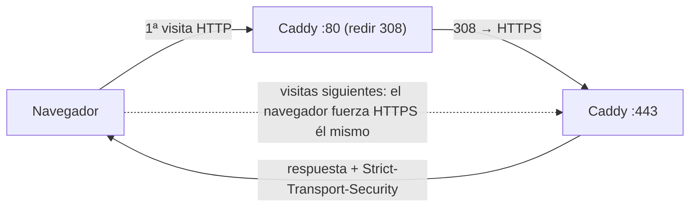

# ADR 0029 — HSTS en el gateway para cerrar el canal seguro (Escenario 1)

| Campo | Valor |
| :--- | :--- |
| **Estado** | Propuesta |
| **Fecha** | 2026-11-23 (commit que la implementa) |
| **Dominios afectados** | Infraestructura / CI (`gateway/Caddyfile`, `gateway/tests/test_gateway_config.py`) |

## Contexto
El Prototipo 3 define cinco escenarios de seguridad. El Escenario 1 (Canal seguro, táctica *Encrypt data* de Bass §11.2, patrón *Secure Channel*) exige que todo el tráfico externo viaje cifrado y que nadie en la misma red pueda leer ni alterar lo que va entre el navegador y TINT.

La línea base medida sobre `develop` (commit `5767874`, ver [evidencia-linea-base.md](../evidencia-linea-base.md) P7-P9) mostró que el gateway Caddy ya cumple dos de las tres propiedades del escenario:

1. **Redirección HTTP→HTTPS:** el bloque HTTP responde `redir … 308` (ADR 0020).
2. **TLS 1.2 o superior:** `testssl.sh` solo observó TLS 1.2 y TLS 1.3; ningún protocolo anterior.

Faltaba la tercera: la cabecera **HSTS** (`Strict-Transport-Security`) estaba ausente (P8). Sin ella, la primera petición de un usuario que escribe `http://…` o sigue un enlace `http://` viaja en claro hasta recibir el 308, y un atacante en la misma Wi-Fi puede interceptarla o degradar la conexión (*SSL stripping*) antes de la redirección. HSTS cierra ese hueco: tras la primera visita exitosa por HTTPS, el navegador convierte por su cuenta toda petición a ese host en HTTPS y rechaza certificados no válidos, sin volver a tocar HTTP plano.

La ruta de medios de MinIO (`:9000`) sigue sirviéndose en claro (P9); queda fuera del gateway por la firma SigV4 (ADR 0020) y se trata como excepción documentada, no como parte de esta decisión.

## Decisión
El bloque HTTPS del `gateway/Caddyfile` emite en cada respuesta la cabecera:

```
header Strict-Transport-Security "max-age=31536000; includeSubDomains; preload"
```

- `max-age=31536000`: un año. El navegador recuerda durante ese tiempo que este host es solo HTTPS.
- `includeSubDomains`: la regla cubre también los subdominios del host.
- `preload`: habilita la inclusión del dominio en la lista de precarga HSTS de los navegadores (requiere el registro aparte en [hstspreload.org](https://hstspreload.org); el token en la cabecera es el prerrequisito).

La cabecera vive **únicamente** en el sitio HTTPS (`https://{$GATEWAY_HOST:localhost}`). El bloque del redirector HTTP plano no la emite, porque HSTS sobre HTTP se ignora por especificación y anunciarla ahí no aporta nada.



La propiedad queda fijada por una prueba unitaria en `gateway/tests/test_gateway_config.py` (`test_gateway_sends_hsts_header_on_https`), que verifica el valor exacto de la cabecera, que esté en el bloque HTTPS y que **no** esté en el redirector HTTP. El CI valida la sintaxis del Caddyfile con `caddy validate` en la imagen oficial fijada (`caddy:2.9-alpine`), sin cambios respecto a ADR 0020.

## Alternativas consideradas
| Alternativa | Por qué no |
| :--- | :--- |
| No usar `preload` | `preload` protege incluso la primerísima visita de un dominio nunca antes visto, al venir el host ya marcado en el navegador. El token en la cabecera no tiene coste y es el prerrequisito para registrarse en la lista; omitirlo deja esa primera visita expuesta. |
| `max-age` corto (p. ej. un día) | Una ventana corta reabre el hueco cada día tras expirar. Un año es el valor recomendado para HSTS en producción. En desarrollo con `localhost` el efecto es inocuo (el navegador solo fija la política para ese host). |
| Poner HSTS también en el bloque HTTP | Los navegadores ignoran `Strict-Transport-Security` recibido por HTTP (RFC 6797 §7.2). No aporta seguridad y confunde la configuración. |
| Resolver MinIO en claro dentro de este ADR | MinIO queda fuera del gateway por la firma SigV4 (ADR 0020). Publicarlo por el gateway o darle TLS propio es un cambio aparte; aquí solo se documenta como excepción conocida. |

## Consecuencias
**Positivas**
- Cierra la tercera propiedad del Escenario 1: el navegador deja de usar HTTP plano para el gateway tras la primera visita, sin depender del 308.
- Mitiga el *SSL stripping* de un atacante en la misma red (fuente y estímulo del escenario).
- Coste de rendimiento nulo: es una cabecera de respuesta; no añade saltos ni handshakes. El p95 del handshake TLS no cambia por esta medida.
- Propiedad verificada de forma continua por una prueba unitaria y por `caddy validate` en CI.

**Negativas / Limitaciones**
- La ruta de medios de MinIO (`:9000`) sigue en claro; es la única parte del escenario no cubierta y se registra como excepción (ADR 0020).
- `preload` solo surte efecto completo tras registrar el dominio en la lista de precarga, un paso manual externo al repositorio.

**Riesgos**
- `includeSubDomains` + `preload` obligan a que **todos** los subdominios del dominio de producción sirvan HTTPS válido. Antes de registrar el dominio en la lista de precarga hay que confirmar que ningún subdominio dependa de HTTP. En `localhost` y en desarrollo no hay riesgo.
- Revertir HSTS en un navegador que ya la fijó requiere esperar a que expire `max-age` o enviar `max-age=0`; no es instantáneo para usuarios que ya visitaron el sitio.

## Referencias
- Código: `gateway/Caddyfile`, `gateway/tests/test_gateway_config.py`
- Documentos: [docs/pruebas-seguridad.md](../pruebas-seguridad.md), [docs/evidencia-linea-base.md](../evidencia-linea-base.md), [ADR 0020](0020-entrada-unica-https-y-topologia-produccion.md)
- Normas: RFC 6797 (HTTP Strict Transport Security); Bass, Clements, Kazman, *Software Architecture in Practice*, 4.ª ed., §11.2.
