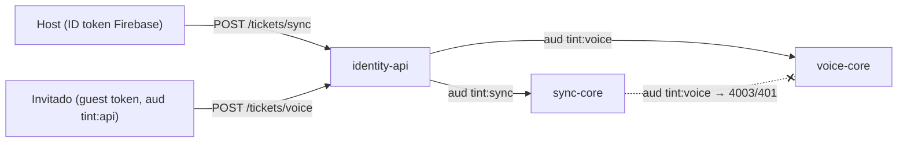

# ADR 0030 — Un ticket por servicio: audiencia propia y mínimo privilegio (Escenario 4)

| Campo | Valor |
| :--- | :--- |
| **Estado** | Propuesta |
| **Fecha** | 2026-11-23 |
| **Dominios afectados** | `services/identity-api`, `services/sync-core`, `services/social-core`, `services/voice-core`, `services/stream-core`, `services/analytics`, `apps/web`, `apps/android`, infra (`docker-compose.yml`, `.env.example`) |

## Contexto
Prototipo 3, escenario 4 (tácticas *Limit exposure* y *Authorize actors* de Bass §11.2, patrón *Least Privilege*). Hoy todos los JWT HS256 que emite identity-api llevan la misma audiencia, `aud = tint:room` (`JWT_AUDIENCE`):

- el **guest token** (4 h) sirve a la vez para la API REST de identity-api y para abrir `/ws/sync`, `/ws/social` y `/ws/voice`;
- el **sync-ticket** del host (10 min) abre sync, social, voz, la transmisión (WHIP) y el historial del chat;
- el **analytics-ticket** sale del mismo generador (`generateHostTicket`) y también lo acepta sync-core.

Un token filtrado del servicio menos sensible abre todos los demás, y cada servicio confía en un token que no se hizo para él. La línea base no tenía prueba para este escenario ([evidencia-linea-base.md](../evidencia-linea-base.md) §3).

## Decisión
**Una audiencia por servicio** y un endpoint que emite el ticket de un solo servicio.

### Audiencias
| Audiencia | La verifica | Token que la lleva |
| :--- | :--- | :--- |
| `tint:api` | identity-api (REST) y su `auth/check` para rutas de identity-api | guest token (sesión del invitado) |
| `tint:sync` | sync-core (`/ws/sync`) | ticket `sync` |
| `tint:social` | social-core (`/ws/social`, `GET /api/v1/social/...`) | ticket `social` |
| `tint:voice` | voice-core (`/ws/voice`, `/api/v1/voice/...`) | ticket `voice` |
| `tint:stream` | stream-core (`/api/v1/stream/...`, WHIP/WHEP) | ticket `stream` |
| `tint:analytics` | analytics (`/api/v1/rooms/{id}/kpis`, `/reactions/heatmap`, `/timeline`) | ticket `analytics` |

Cada servicio lee **su** audiencia de `JWT_AUDIENCE` (la variable ya existe; Compose le da el valor del servicio) y rechaza cualquier otra. El ID token de Firebase del host no cambia (su `aud` es el proyecto de Firebase y solo lo verifica identity-api).

### Endpoint
`POST /api/v1/rooms/:id/tickets/:service`, con `service ∈ {sync, social, voice, stream, analytics}`.

| Llamante | Servicios permitidos | Claims del ticket |
| :--- | :--- | :--- |
| Host dueño de la sala (ID token de Firebase; mismas guardas que hoy `sync-ticket`: `requireAuthHost`, `requireRoomOwner`, `requireReadableRoom`) | los cinco | `role: host`, `jti` nuevo |
| Invitado de la sala (guest token `tint:api` de esa sala, no revocado ni bloqueado) | `sync`, `social`, `voice`, `stream` | `role: participant`, **mismo `sub`, `nick` y `jti` que su sesión** |

- Respuesta `200 {"token", "expires_at", "audience"}`. `aud = tint:<service>`, `iss = JWT_ISSUER`, `exp = iat + SERVICE_TICKET_TTL_SECONDS` (600 por defecto), sin superar el `exp` de la sesión del invitado.
- Errores: servicio desconocido → `404`; invitado pidiendo `analytics` → `403`; invitado de otra sala → `403`; sala deshabilitada → `410 {error:"Disabled"}` (ADR 0019).
- El ticket del invitado **hereda el `jti` de su sesión**: retirar al invitado (`token:revoked:{jti}`, ADR 0007) revoca a la vez todos sus tickets, también los ya emitidos.

### Gateway (`forward_auth` → `GET /api/v1/internal/auth/check`)
identity-api elige la audiencia esperada según la ruta original (`X-Forwarded-Uri`): `/ws/sync` → `tint:sync`, `/ws/social` y `/api/v1/social/` → `tint:social`, `/ws/voice` y `/api/v1/voice/` → `tint:voice`, `/api/v1/stream/` → `tint:stream`, las tres rutas de analytics → `tint:analytics`, el resto de `/api/` → `tint:api`. Un HS256 con otra audiencia → `401`. Los ID tokens de Firebase siguen pasando solo hacia rutas de identity-api.

### Transición
Para mergear por dominio sin romper nada:
1. Los verificadores aceptan además la audiencia de `JWT_LEGACY_AUDIENCE` **solo si la variable tiene valor** (vacía = desactivada; falla cerrado). `.env.example` la trae con `tint:room` mientras dure la transición.
2. `sync-ticket` y `analytics-ticket` siguen existiendo y emiten la audiencia legada hasta que web y Android pidan sus tickets nuevos. El guest token se emite con la audiencia legada mientras `JWT_LEGACY_AUDIENCE` tenga valor (la web vieja lo usa directo en los WebSocket) y con `tint:api` cuando esté vacía. identity-api acepta en REST y en `/tickets/:service` tanto `tint:api` como la legada mientras dure la transición.
3. Último PR (infra): `JWT_LEGACY_AUDIENCE` vacía, se borran `sync-ticket` y `analytics-ticket`, y `env-check` rechaza secretos de ejemplo (`*change-in-prod*`, `*change-me*`) cuando `NODE_ENV=production`.

Orden de merge: este ADR → identity-api → sync, social, voice, stream, analytics (cualquier orden) → web → Android → infra (cierre de la transición).

## Criterios de aceptación (verificables)
- **AC1:** un ticket `tint:<a>` presentado en el servicio `b ≠ a` se rechaza el 100 % de las veces (WebSocket: cierre `4003`, igual que un token inválido tras el upgrade; REST: `401`). Lo comprueba una prueba por servicio y `bench/` (matriz 5 × 5).
- **AC2:** el gateway responde `401` a un HS256 cuya audiencia no corresponde a la ruta.
- **AC3:** un invitado no obtiene ticket `analytics` (`403`) ni ticket de otra sala (`403`).
- **AC4:** retirar a un invitado revoca sus tickets ya emitidos (cierre `4001` en el canal abierto).
- **AC5:** con `JWT_LEGACY_AUDIENCE` vacía, un token `tint:room` se rechaza en todos los servicios.
- **AC6:** el p95 de emitir un ticket y el p95 de `ws_connecting` no suben más de 10 % frente a la línea base (`ws_connecting` p95 135 ms).

## Alternativas consideradas
| Alternativa | Por qué no |
| :--- | :--- |
| Un ticket con `aud` en lista según el rol | Menos cambios, pero un ticket robado sigue abriendo varios servicios: no es mínimo privilegio. |
| Reusar `/sync-ticket?service=` | El nombre deja de decir lo que hace y mezcla dos contratos en uno. |
| Una clave por servicio o firmas asimétricas (RS256/EdDSA) | Es la mejora siguiente (ningún servicio podría falsificar tickets de otro), pero cambia el manejo de secretos de todos los servicios; queda fuera de esta entrega. |

## Consecuencias
**Positivas**
- Un token filtrado solo abre el servicio para el que se emitió, y por 10 min.
- El invitado puede renovar sus tickets al reconectar (hoy no puede renovar su token).

**Negativas**
- Un pedido HTTP más por canal al abrir la sala (hasta 4 para el host, 3-4 para el invitado).
- Todos los servicios siguen compartiendo `JWT_SECRET`: un servicio comprometido podría firmar tickets de otro (límite conocido).

## Referencias
- Documentos: [usuarios-e-identidad §4](../usuarios-e-identidad.md#4-esquemas-de-tokens), [ADR 0006](0006-tickets-jwt-hs256-emitidos-por-identity-api.md), [ADR 0007](0007-revocacion-por-clave-redis-y-cierre-4001.md), [ADR 0019](0019-salas-live-y-cierre-room-closed.md), [ADR 0022](0022-secretos-por-variables-de-entorno.md)
- Bass, Clements, Kazman, *Software Architecture in Practice*, 4.ª ed., §11.2.
