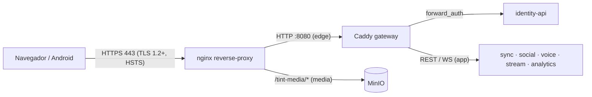

# ADR 0031 — nginx en el borde y Caddy como router interno

| Campo | Valor |
| :--- | :--- |
| **Estado** | Propuesta |
| **Fecha** | 2026-11-23 |
| **Dominios afectados** | Infraestructura (`reverse-proxy/`, `gateway/Caddyfile`, `docker-compose.yml`, `docker-compose.production.yml`, `bench/`, CI) |

## Contexto
La vista de despliegue del Prototipo 3 separa dos elementos: un **reverse proxy** (nginx) que es la única entrada pública y un **API Gateway** (Caddy) que enruta y autentica. Hasta ahora Caddy hacía las dos cosas. Eso dejaba tres problemas:

1. **Escenario 1:** los vídeos salían de MinIO en claro por el puerto 9000 (excepción documentada en ADR 0029); el puerto seguía publicado en producción.
2. **Escenario 2:** con una sola pieza, el límite por IP y el límite por usuario viven en el mismo proceso que hace `forward_auth`; una avalancha llega entera a Caddy.
3. **Resiliencia:** no había un punto donde acotar tiempos, reintentar ni repartir carga antes del router.

## Decisión
**nginx (`reverse-proxy/`, `nginx:1.27.5-alpine`) es el borde; Caddy (`gateway/`) pasa a ser un router interno en HTTP `:8080` sin puertos publicados.**

| Responsabilidad | nginx (`reverse-proxy`) | Caddy (`gateway`) |
| :--- | :--- | :--- |
| Puertos publicados | 80 y 443 (`GATEWAY_HTTP_PORT`, `GATEWAY_HTTPS_PORT`) | ninguno |
| TLS (escenario 1) | `ssl_protocols TLSv1.2 TLSv1.3`; certificado en `/etc/nginx/certs` (real en producción; autofirmado para `GATEWAY_HOST` en desarrollo si falta) | — |
| HTTP → HTTPS | `308` | — |
| HSTS y cabeceras de seguridad (escenarios 1 y 2) | `add_header … always` en el sitio 443 | solo `-Server` |
| Límite por IP (escenario 2) | `limit_req` grueso: `EDGE_RATE_PER_IP` r/s con ráfaga `EDGE_BURST_PER_IP` (300/600 por defecto); 429 JSON con `Retry-After` | límite por IP de invitaciones (600/10 s) con la IP que pasa nginx |
| Límite por usuario | — | 100/10 s tras `forward_auth` (ADR 0028) |
| Tamaño del cuerpo | `client_max_body_size 1m` (413 JSON) | `request_body 1MB` (defensa en profundidad) |
| Vídeos (escenario 1) | `location /tint-media/` → `minio:9000` por la red `media`, conservando `Host` para la firma SigV4; sin límite de cuerpo, sin buffering (subidas y `Range`) | — |
| Rutas, `forward_auth`, 404 a `/internal/*` | — | sí |
| Resiliencia | `max_fails`/`fail_timeout`, `keepalive`, `proxy_connect_timeout 5s`, `proxy_next_upstream` solo para fallos de conexión, 503 JSON con `Retry-After` | timeouts por servicio (ADR 0020) |
| Logs | JSON a stdout con `correlation_id` (ADR 0021) | igual |

- **IP real del cliente:** nginx **sobrescribe** `X-Forwarded-For` con `$remote_addr` (no lo añade), y Caddy confía en él (`trusted_proxies static private_ranges`, `client_ip_headers X-Forwarded-For`). Así un cliente no puede mandar una IP falsa para saltarse el límite por IP.
- **Cabeceras hacia los upstreams:** `snippets/proxy-headers.conf` se incluye en cada `location` con `proxy_pass`, porque en nginx un `proxy_set_header` dentro de un `location` borra todos los heredados del `server`.
- **URLs firmadas:** identity-api firma con `MINIO_PUBLIC_ENDPOINT=https://<host>` (por defecto `https://localhost`); el navegador pide `https://<host>/tint-media/<clave>?X-Amz-…` y MinIO verifica la firma con el mismo `Host`. En producción MinIO ya no publica ningún puerto.
- **Redes (ADR 0027):** `reverse-proxy` está en `edge` y `media`; `gateway` deja `media` y queda en `edge` y `app`. Solo el borde alcanza MinIO desde fuera de `data`.

## Verificación (imagen real, 2026-11-23)
Con `reverse-proxy`, `gateway` y `minio` levantados en un proyecto aislado:

| Prueba | Resultado |
| :--- | :--- |
| `http://…/x?a=1` | `308 https://…/x?a=1` |
| Cabeceras en 443 | HSTS, `nosniff`, `DENY`, `Referrer-Policy`, CSP; `Server: nginx` sin versión |
| TLS 1.1 forzado | conexión rechazada |
| `POST /api/v1/internal/rooms/x/disable` | 404 (Caddy) |
| `/api/*` sin identity-api | 503 JSON |
| Cuerpo de 1,1 MB | 413 JSON |
| Ráfaga con `EDGE_RATE_PER_IP=5` | 429 con `Retry-After: 1` |
| URL firmada por `/tint-media/` (PUT / GET con `Range`) | 200 / 206; URL alterada 403 |
| `X-Forwarded-For` falso del cliente | descartado: Caddy ve la IP real |

Las dos últimas filas encontraron dos errores que la prueba estática no veía (cabeceras perdidas por `proxy_set_header` en el `location` y la IP falsificable); quedan fijados en `gateway/tests/test_reverse_proxy.py`.

## Alternativas consideradas
| Alternativa | Por qué no |
| :--- | :--- |
| nginx en modo TCP (passthrough) | No descifra: no puede poner HSTS, limitar ni servir `/tint-media/`; añade un salto sin valor. |
| nginx en lugar de Caddy | Habría que rehacer `forward_auth` con `auth_request` y todo el ruteo y sus pruebas; más riesgo sin beneficio. |
| Dar TLS propio a MinIO en 9000 | Deja un segundo puerto público y otro certificado que mantener; por el borde basta uno. |

## Consecuencias
**Positivas**
- Escenario 1 completo: ningún tráfico externo en claro; MinIO sin puertos en producción.
- Dos capas de límite (IP en el borde, usuario en el router): una avalancha se corta antes de `forward_auth`.
- El borde se puede escalar o cambiar sin tocar el ruteo.

**Negativas**
- Un salto más (nginx → Caddy) dentro del host; se mide en el banco.
- El banco genera la carga desde una sola IP: hay que subir `EDGE_RATE_PER_IP` al medir capacidad.

**Riesgos**
- Si un servicio nuevo se publica fuera del borde, se salta todo esto; `test_reverse_proxy.py` exige que solo nginx publique 80/443.

## Referencias
- Código: `reverse-proxy/`, `gateway/Caddyfile`, `docker-compose.yml`, `docker-compose.production.yml`, `gateway/tests/test_reverse_proxy.py`
- ADR 0020, 0021, 0027, 0028, 0029
