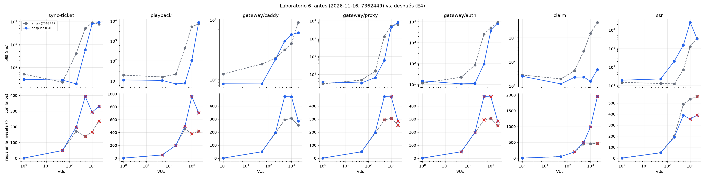
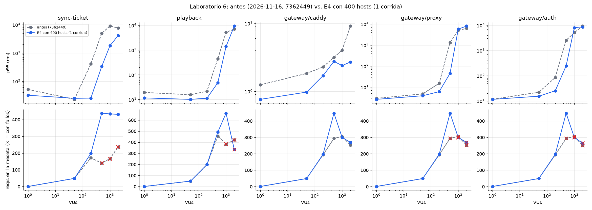

# Evolución del sistema con el Prototipo 3 (medida en una sola máquina)

Qué cambió en el comportamiento de TINT al sumar las medidas de seguridad del Prototipo 3, medido en **la misma máquina** que el Laboratorio 6 del 2026-11-16. Esta entrega cubre dos cosas: el **gate funcional de E4** (la rama de integración) por la entrada real y el **Laboratorio 6 completo en E4**, comparado con la corrida del 2026-11-16. Todo número de este documento sale de una corrida hecha aquí; lo que no se midió está en [§5](#5-pendiente).

## 1. Entorno

| Campo | Valor |
| :--- | :--- |
| Máquina | AMD Ryzen 3 2200G (4 núcleos), 13,5 GB de RAM, Linux 7.2.11 (Arch), Docker 29.9.2. **Stack y generador de carga en la misma máquina** |
| Generador | k6 v2.4.0 (imagen `grafana/k6:2.4.0`, red del host), `bench/run.py --local` |
| Ruido | dos navegadores de escritorio abiertos (Firefox y Brave, ~5-8 % de CPU cada uno en reposo) y un contenedor ajeno (`tintedge-reverse-proxy-1`, 0 % de CPU, puertos 18080/18443); nada más corría |
| Antes (Lab 6) | 2026-11-16, 22:45-23:53, `develop` en `7362449` (sistema funcionalmente previo al Prototipo 3), proyecto `tintlab6` |
| Después (E4) | `chore/integracion-p3` en `93f3dd5` (S1 HSTS, S2 límites y cabeceras, S3 redes por capa, S4 un ticket por servicio, S5 audit-log, nginx en el borde y 2 réplicas de identity-api), imágenes construidas de ese commit (`bench/run.py --local prepare --commit`, etiqueta `e4`) |
| Herramientas | esta rama, `chore/bench-evolucion-p3` (integración + banco del Lab 6 + `--local` con commit fijado) |

E0…E3 se prepararon (árboles e imágenes `e0`…`e3`), pero esta entrega no los mide (ver §5).

## 2. Gate funcional de E4 por la entrada real

Stack completo de E4 (`docker compose`, 20 servicios, proyecto aislado `tintevo`, volúmenes propios) publicado en `https://localhost:443`, como `make up`.

### 2.1 Camino de la API (a mano, `curl` y Python por TLS)

| Paso | Resultado |
| :--- | :--- |
| `GET https://localhost/healthz` | 200 `{"status":"ok","service":"reverse-proxy"}` (lo responde nginx) |
| `GET /api/v1/healthz` | 200 `{"status":"ok","service":"identity-api"}` |
| Cabeceras | `strict-transport-security: max-age=31536000; includeSubDomains; preload`, `x-content-type-options`, `x-frame-options: DENY`, `referrer-policy`, CSP `frame-ancestors 'none'`; `server: nginx` (sin versión) |
| Login con el Firebase Auth Emulator (`accounts:signUp` en `127.0.0.1:9099`) | ID token emitido |
| `POST /api/v1/rooms` con ese ID token | 200 |
| `POST /api/v1/rooms/:id/tickets/sync` | 200, `aud = tint:sync` |
| `GET /ws/sync?room_id&token=<ticket sync>` | 101 y el canal queda abierto |
| `POST /api/v1/rooms/:id/sync-ticket` (legado) y `/ws/sync` con él | 200 `aud = tint:room` y 101 (lo acepta por `JWT_LEGACY_AUDIENCE=tint:room`, transición de ADR 0030) |

### 2.2 `make e2e-system` (Chromium real por `https://localhost`)

Se corrió `scripts/e2e/run.sh` de cada árbol cambiando solo el nombre del contenedor del media-worker (`tint-media-worker` → `tintevo-media-worker-1`, porque el banco no fija `container_name`).

| Corrida | Etapa | Resultado |
| :--- | :--- | :--- |
| watch | E4 | 9 de 10 en verde; falla "la trivia *en este momento* llega a la invitada" |
| live #1 | E4 | 5 de 10 en verde; fallan "el host lanza una encuesta", "programa una trivia", "ve a la invitada para subirla al escenario", "voz del escenario" (esperas de 20 s agotadas) |
| live #2 | E4 | interrumpida al inicio (espera de 30 s); invalidada: en paralelo corrí una prueba propia contra el mismo stack |
| live #3 | E4 | 7 de 11: fallan los mismos 4 pasos del host que en #1 |
| live #4 (mismo script con un registro extra solo en el `catch` de la encuesta) | E4 | 11 de 12: encuesta, trivia "lanzar ahora", escenario y voz **pasan**; falla el último paso (aviso de fin a la invitada, espera de 5 s) |
| live (mismo script de #4) | E4 | interrumpida al inicio por una espera de 30 s, sin interferencia mía |
| live | E0 (`5767874`) | **12 de 12 en verde**, en las mismas condiciones |

**Lectura.** El camino de la API de E4 funciona por la entrada real. El E2E de E4 **no quedó en verde** en ninguna corrida, pero los pasos que fallan cambian entre corridas (en #4 pasan los que fallaron en #1 y #3), así que no hay un paso que E4 rompa siempre. En esta máquina, con Chromium renderizando por software tres páginas con vídeo (~250 % de CPU), las esperas fijas del E2E (5-20 s) se agotan; E0 pasó una vez en las mismas condiciones. Con una sola corrida de E0 no se puede afirmar si E4 es más lento en la interfaz del host o si fue azar: **queda abierto** (ver §5).

### 2.3 Fallos encontrados durante el gate

1. **Arranque en frío de E4 con 2 réplicas de identity-api.** En el primer `docker compose up -d` sobre volúmenes vacíos, las dos réplicas corrieron `drizzle-kit migrate` a la vez; una salió con error (`RestartCount 1`), quedó *unhealthy* y `up` terminó con `dependency failed to start: container tintevo-identity-api-2 is unhealthy`, dejando `gateway` y `reverse-proxy` en *Created*. Un segundo `up -d` levantó todo. `bench/run.py` ahora reintenta `up` una vez y lo anota en `bench/results/_up_reintentos.log`; en las 17 recreaciones posteriores del Lab 6 (stack reducido, 2 réplicas) no hizo falta ningún reintento, así que la carrera es intermitente.
2. **analytics no consume el cuerpo de las peticiones internas** (ya estaba en E0: el código de `/internal/events/start` es el mismo). Al reutilizar identity-api la conexión keep-alive, la siguiente petición llega pegada al cuerpo anterior (`{"roomId":…}POST /internal/events/start/…` → 501) y `POST /api/v1/events/start` responde 503 "No se pudo iniciar el evento". Se vio al iniciar un segundo evento `live` a los ~3 s del primero.
3. En la página de la invitada (watch, E4) aparecen errores de hidratación de React (#418, #423, #425). No bloquean el flujo; no se revisó si también salen en E0.

## 3. Laboratorio 6: antes (2026-11-16, `7362449`) vs. después (E4)

### 3.1 Método (igual que el 2026-11-16)

| Campo | Antes | Después (E4) |
| :--- | :--- | :--- |
| Fecha | 2026-11-16, 22:45-23:53 | 2026-11-23, 20:57-22:05 |
| Comando | `bench/run.py --local lab6 --label lab6-local` (+ `--runs 1 --targets rooms,ssr`) | el mismo: `bench/run.py --local --image-tag e4 --project tintlab6 lab6 --label evo/lab6-e4` (+ `--runs 1 --targets rooms,ssr`) |
| Carga | `bench/k6/lab6.js`, `ramping-vus` 1, 50, 200, 500, 1000, 2000 VUs, rampa 5 s, meseta 30 s, `sleep(1)`, **1 host y 1 invitado** (`--hosts 1`), 3 salas; `rooms` con 300 salas sembradas | igual |
| Corridas | 3 de gateway, playback, sync-ticket y claim; 1 de rooms y ssr; stack recreado (`down -v` + `up`) antes de cada una | igual (14 recreaciones, ninguna necesitó reintento de `up`) |
| Knee | último nivel antes del primero con fallos > 0 o p95 > 10× el p95 base | igual |
| Medición extra | `docker stats` y CPU de la máquina | igual |
| Stack | gateway (Caddy), web, identity-api (1 proceso), PostgreSQL, Redis, MinIO, emulador | lo mismo **más** `reverse-proxy` (nginx, ADR 0031) delante de Caddy y **2 réplicas** de identity-api (ADR 0032) |
| Entrada | `https://localhost:8443` → Caddy | `https://localhost:8443` → nginx → Caddy |

Diferencias que hay que tener presentes al leer las tablas:

- **Límite por IP de nginx subido** (`EDGE_RATE_PER_IP=100000`, `EDGE_BURST_PER_IP=100000`; por defecto 300/600): toda la carga sale de una IP. Los límites de Caddy (S2, ADR 0028) **se dejaron como vienen**: 100 peticiones cada 10 s por usuario verificado (`X-User-Id`) en `/api/*` y 600 cada 10 s por IP en `/api/v1/invitations/*`.
- **Con `--hosts 1`, todos los VUs son el mismo usuario.** Desde E2 el límite por usuario corta ese patrón a 10 req/s: en sync-ticket, playback y la capa `auth` del gateway casi todo lo que pasa de 10 req/s es 429. Es el límite haciendo su trabajo, no saturación; por eso, además, se corrió una variante con 400 hosts (§3.4).
- `lab6.js` cuenta ahora los 429 y los 5xx (o sin respuesta) por nivel (columnas `429` y `5xx/0`); la carga no cambia.
- La capa `gateway/caddy` (`GET /healthz`) en E4 **la responde nginx** (`location = /healthz`), no Caddy.
- `ssr` (`GET /invite/:code`) pasa en E4 por nginx → Caddy → web (un salto más que antes).
- `req/s máx` es el mayor throughput de un nivel con menos de 1 % de fallos; el req/s de las tablas por nivel cuenta también las respuestas con error (429, 5xx).

### 3.2 Resumen

| Prueba | Knee antes | Knee después | Knee por corrida (antes → después) | req/s máx (fallos < 1 %) antes | después | Primer síntoma antes | Primer síntoma después |
| :--- | ---: | ---: | :--- | ---: | ---: | :--- | :--- |
| sync-ticket | 50 | 1 | 50, 50, 50 → 1, 1, 1 | 172 | 1 | 200 VUs: p95 410 ms, fallos 0 % | 50 VUs: p95 28 ms, fallos 79,7 % (1181 × 429) |
| playback | 200 | 1 | 50, 200, 500 → 1, 1, 1 | 456 | 1 | 500 VUs: p95 444 ms, fallos 0 % | 50 VUs: p95 10 ms, fallos 79,9 % (1191 × 429) |
| gateway/caddy (E4: nginx) | 2000 | 2000 | 2000 ×3 → 2000 ×3 | 306 | 472 | sin degradación (p95 9 ms a 2000) | sin degradación (p95 6 ms a 2000) |
| gateway/proxy (`/api/v1/healthz`) | 200 | 200 | 200, 200, 200 → 200, 200, 500 | 294 | 472 | 500 VUs: p95 1289 ms, fallos 0,36 % | 500 VUs: p95 61 ms, fallos 0 % |
| gateway/auth (playback) | 200 | 1 | 200, 200, 200 → 1, 1, 1 | 294 | 1 | 500 VUs: p95 2544 ms, fallos 0,86 % | 50 VUs: p95 11 ms, fallos 79,8 % (1186 × 429) |
| claim | 200 | 50 | 200, 200, 200 → 50, 50, 50 | 462 | 50 | 500 VUs: p95 277 ms, fallos 0 % | 200 VUs: p95 23 ms, fallos 69,9 % (4152 × 429) |
| rooms (300 salas) | 50 | sin datos | 50 → — | 102 | — | 200 VUs: p95 1865 ms | el sembrado recibe 429 (ver §3.5) |
| ssr `/invite/:code` (1 corrida) | 500 | 50 | 500 → 50 | 536 | 388 | 1000 VUs: p95 1259 ms, fallos 0 % | 200 VUs: p95 208 ms, fallos 0 % |

Las 14 ejecuciones de k6 de E4 terminaron con código 0, salvo `rooms` (107, ver §3.5).

### 3.3 Lectura

- **Con el mismo método, el knee de E4 lo marca el escenario 2, no la capacidad.** sync-ticket, playback y la capa `auth` caen a knee 1 VU: a 50 VUs pasan ~300 respuestas 2xx en 30 s (10 req/s, justo el límite de 100/10 s) y el resto es 429, con p95 de 10-28 ms. claim queda en knee 50 por el límite por IP de las invitaciones (60 req/s): a 200 VUs el 69,9 % es 429. Los 5xx aparecen solo desde 1000 VUs. Es decir: un único usuario ya no puede empujar al sistema hasta saturarlo, que es lo que el escenario 2 buscaba.
- **El camino a identity-api sin límite de usuario mejoró con las 2 réplicas.** `gateway/proxy` (`/api/v1/healthz`, sin autenticación ni límite por usuario) mantiene el knee en 200 VUs, pero a 500 VUs su p95 baja de 1289 ms a 61 ms y los fallos de 0,36 % a 0 %; a 1000 VUs, de 12,0 % a 1,8 % de fallos; el throughput sano sube de 294 a 472 req/s. El tercer run tuvo knee 500.
- **nginx en el borde no se nota en la capa que responde solo:** `/healthz` (ahora nginx) da p95 ≤ 6 ms hasta 2000 VUs, sin fallos, igual que Caddy antes (≤ 9 ms).
- **SSR empeoró en la única corrida:** knee de 500 a 50 VUs, p95 a 200 VUs de 12 ms a 208 ms, throughput sano de 536 a 388 req/s, y a 1000 VUs 3,4 % de fallos con p95 de 25,6 s. Una sola corrida y el generador al 72,9 % de CPU media no bastan para atribuirlo; la diferencia de camino (nginx → Caddy → web) es la candidata. **No concluyente.**
- **rooms no se pudo medir** con el mismo método: el límite por usuario corta el sembrado de 300 salas de un solo host.
- **CPU:** en sync-ticket la CPU media de identity-api pasó de 43,5 % (un proceso) a 19,8 % + 19,4 % (dos réplicas), pero con 1 host casi todo se responde con 429 antes de llegar a la ruta, así que no compara carga igual; la comparación de capacidad está en §3.4.

### Tablas por nivel (mediana de las corridas; antes y después)

#### sync-ticket

**Antes (7362449)**

| VUs | avg (ms) | p95 (ms) | p99 (ms) | req/s | Peticiones | Fallos |
| ---: | ---: | ---: | ---: | ---: | ---: | ---: |
| 1 | 24.76 | 51.07 | 70.09 | 1.0 | 30 | 0.00% |
| 50 ← knee | 13.26 | 22.69 | 33.87 | 49.2 | 1476 | 0.00% |
| 200 ← degrada | 170.81 | 410.32 | 1808.30 | 171.7 | 5150 | 0.00% |
| 500 | 2490.78 | 4995.00 | 5162.01 | 140.2 | 4207 | 0.07% |
| 1000 | 4554.47 | 8991.10 | 9552.66 | 166.8 | 5005 | 14.37% |
| 2000 | 7319.67 | 7736.63 | 8084.23 | 237.0 | 7109 | 99.71% |

Knee: 50 VUs; primer nivel degradado: 200 (p95 410 ms > 10× el p95 base (23 ms)).

**Después (E4)**

| VUs | avg (ms) | p95 (ms) | p99 (ms) | req/s | Peticiones | Fallos | 429 | 5xx/0 |
| ---: | ---: | ---: | ---: | ---: | ---: | ---: | ---: | ---: |
| 1 ← knee | 23.02 | 30.29 | 44.69 | 1.0 | 30 | 0.00% | 0 | 0 |
| 50 ← degrada | 9.94 | 28.05 | 51.61 | 49.4 | 1481 | 79.74% | 1181 | 0 |
| 200 | 7.93 | 19.11 | 76.86 | 198.1 | 5944 | 94.95% | 5644 | 0 |
| 500 | 273.39 | 581.13 | 1134.60 | 392.6 | 11778 | 97.45% | 11478 | 0 |
| 1000 | 2400.57 | 8022.13 | 8768.55 | 293.6 | 8808 | 97.79% | 8532 | 37 |
| 2000 | 4940.75 | 9297.46 | 11615.14 | 331.1 | 9934 | 99.95% | 8178 | 2506 |

Knee: 1 VUs; primer nivel degradado: 50 (fallos 79.74%).

Recursos antes:

CPU del portátil: media 68.6 %, máx 100.0 % (posible límite del generador).

| Contenedor | CPU media | CPU máx | Memoria máx |
| --- | ---: | ---: | ---: |
| tintlab6-gateway-1 | 20.1 % | 135.9 % | 451 MiB |
| tintlab6-identity-api-1 | 43.5 % | 114.9 % | 405 MiB |
| tintlab6-postgres-1 | 32.2 % | 82.5 % | 57 MiB |
| tintlab6-web-1 | 0.5 % | 7.4 % | 35 MiB |
| tintlab6-redis-1 | 1.3 % | 7.3 % | 16 MiB |

Recursos después:

CPU del portátil: media 62.1 %, máx 99.8 % (posible límite del generador).

| Contenedor | CPU media | CPU máx | Memoria máx |
| --- | ---: | ---: | ---: |
| tintlab6-identity-api-1 | 19.8 % | 123.7 % | 123 MiB |
| tintlab6-identity-api-2 | 19.4 % | 120.0 % | 130 MiB |
| tintlab6-postgres-1 | 32.2 % | 98.3 % | 69 MiB |
| tintlab6-gateway-1 | 16.1 % | 52.3 % | 376 MiB |
| tintlab6-redis-1 | 1.3 % | 8.5 % | 18 MiB |
| tintlab6-web-1 | 0.5 % | 7.1 % | 34 MiB |

#### playback

**Antes (7362449)**

| VUs | avg (ms) | p95 (ms) | p99 (ms) | req/s | Peticiones | Fallos |
| ---: | ---: | ---: | ---: | ---: | ---: | ---: |
| 1 | 9.87 | 19.37 | 22.17 | 1.0 | 30 | 0.00% |
| 50 | 7.81 | 15.67 | 22.01 | 49.5 | 1486 | 0.00% |
| 200 ← knee | 9.35 | 21.70 | 32.51 | 198.0 | 5941 | 0.00% |
| 500 ← degrada | 96.94 | 444.37 | 1152.48 | 455.7 | 13672 | 0.00% |
| 1000 | 1554.44 | 5166.29 | 5686.16 | 382.1 | 11464 | 15.99% |
| 2000 | 3888.51 | 7046.79 | 7945.58 | 420.8 | 12623 | 38.52% |

Knee: 200 VUs; primer nivel degradado: 500 (p95 444 ms > 10× el p95 base (16 ms)).

**Después (E4)**

| VUs | avg (ms) | p95 (ms) | p99 (ms) | req/s | Peticiones | Fallos | 429 | 5xx/0 |
| ---: | ---: | ---: | ---: | ---: | ---: | ---: | ---: | ---: |
| 1 ← knee | 8.38 | 11.13 | 15.49 | 1.0 | 30 | 0.00% | 0 | 0 |
| 50 ← degrada | 4.09 | 10.48 | 17.28 | 49.7 | 1491 | 79.88% | 1191 | 0 |
| 200 | 3.12 | 7.04 | 13.50 | 199.2 | 5977 | 94.98% | 5677 | 0 |
| 500 | 3.36 | 7.71 | 14.83 | 497.6 | 14928 | 97.99% | 14628 | 0 |
| 1000 | 42.46 | 105.59 | 932.27 | 959.7 | 28792 | 98.95% | 28490 | 0 |
| 2000 | 2132.19 | 8463.89 | 10230.55 | 707.7 | 21232 | 98.72% | 19428 | 1533 |

Knee: 1 VUs; primer nivel degradado: 50 (fallos 79.88%).

Recursos antes:

CPU del portátil: media 67.7 %, máx 100.0 % (posible límite del generador).

| Contenedor | CPU media | CPU máx | Memoria máx |
| --- | ---: | ---: | ---: |
| tintlab6-identity-api-1 | 48.6 % | 116.5 % | 225 MiB |
| tintlab6-gateway-1 | 22.9 % | 74.6 % | 565 MiB |
| tintlab6-postgres-1 | 12.1 % | 33.6 % | 48 MiB |
| tintlab6-redis-1 | 2.9 % | 8.3 % | 18 MiB |
| tintlab6-web-1 | 0.4 % | 7.5 % | 38 MiB |

Recursos después:

CPU del portátil: media 56.8 %, máx 100.0 % (posible límite del generador).

| Contenedor | CPU media | CPU máx | Memoria máx |
| --- | ---: | ---: | ---: |
| tintlab6-identity-api-2 | 22.0 % | 89.6 % | 80 MiB |
| tintlab6-gateway-1 | 22.8 % | 81.6 % | 319 MiB |
| tintlab6-identity-api-1 | 22.1 % | 78.3 % | 80 MiB |
| tintlab6-postgres-1 | 1.5 % | 9.9 % | 53 MiB |
| tintlab6-redis-1 | 2.6 % | 8.8 % | 17 MiB |
| tintlab6-web-1 | 0.4 % | 4.8 % | 38 MiB |

#### gateway/caddy

**Antes (7362449)**

| VUs | avg (ms) | p95 (ms) | p99 (ms) | req/s | Peticiones | Fallos |
| ---: | ---: | ---: | ---: | ---: | ---: | ---: |
| 1 | 0.84 | 1.24 | 1.98 | 1.0 | 30 | 0.00% |
| 50 | 0.82 | 1.83 | 3.13 | 49.3 | 1479 | 0.00% |
| 200 | 0.90 | 2.28 | 3.68 | 194.0 | 5819 | 0.00% |
| 500 | 1.30 | 3.15 | 5.23 | 293.7 | 8810 | 0.00% |
| 1000 | 1.55 | 4.03 | 7.70 | 305.7 | 9170 | 0.00% |
| 2000 ← knee | 3.02 | 9.12 | 24.97 | 253.3 | 7598 | 0.00% |

Knee: 2000 VUs; primer nivel degradado: - (sin degradación en los niveles medidos).

**Después (E4)**

| VUs | avg (ms) | p95 (ms) | p99 (ms) | req/s | Peticiones | Fallos | 429 | 5xx/0 |
| ---: | ---: | ---: | ---: | ---: | ---: | ---: | ---: | ---: |
| 1 | 0.51 | 0.85 | 0.97 | 1.0 | 30 | 0.00% | 0 | 0 |
| 50 | 0.47 | 0.85 | 1.54 | 49.5 | 1486 | 0.00% | 0 | 0 |
| 200 | 0.74 | 2.21 | 3.73 | 198.3 | 5950 | 0.00% | 0 | 0 |
| 500 | 1.82 | 4.44 | 6.83 | 472.4 | 14172 | 0.00% | 0 | 0 |
| 1000 | 2.56 | 5.71 | 9.32 | 471.0 | 14131 | 0.00% | 0 | 0 |
| 2000 ← knee | 2.52 | 6.12 | 8.95 | 283.8 | 8515 | 0.00% | 0 | 0 |

Knee: 2000 VUs; primer nivel degradado: - (sin degradación en los niveles medidos).

#### gateway/proxy

**Antes (7362449)**

| VUs | avg (ms) | p95 (ms) | p99 (ms) | req/s | Peticiones | Fallos |
| ---: | ---: | ---: | ---: | ---: | ---: | ---: |
| 1 | 2.01 | 2.93 | 3.74 | 1.0 | 30 | 0.00% |
| 50 | 2.06 | 4.81 | 7.14 | 49.3 | 1479 | 0.00% |
| 200 ← knee | 4.94 | 15.23 | 50.04 | 194.0 | 5819 | 0.00% |
| 500 ← degrada | 191.12 | 1289.27 | 3509.32 | 293.7 | 8810 | 0.36% |
| 1000 | 866.94 | 5004.94 | 5323.17 | 305.7 | 9170 | 12.04% |
| 2000 | 2124.40 | 6221.49 | 6843.75 | 253.3 | 7598 | 22.26% |

Knee: 200 VUs; primer nivel degradado: 500 (fallos 0.36%).

**Después (E4)**

| VUs | avg (ms) | p95 (ms) | p99 (ms) | req/s | Peticiones | Fallos | 429 | 5xx/0 |
| ---: | ---: | ---: | ---: | ---: | ---: | ---: | ---: | ---: |
| 1 | 2.28 | 3.79 | 4.89 | 1.0 | 30 | 0.00% | 0 | 0 |
| 50 | 1.92 | 3.32 | 5.13 | 49.5 | 1486 | 0.00% | 0 | 0 |
| 200 ← knee | 2.54 | 6.62 | 11.12 | 198.3 | 5950 | 0.00% | 0 | 0 |
| 500 ← degrada | 21.35 | 60.77 | 155.89 | 472.4 | 14172 | 0.00% | 0 | 0 |
| 1000 | 584.64 | 4343.24 | 8026.53 | 471.0 | 14131 | 1.82% | 0 | 295 |
| 2000 | 3482.97 | 8129.01 | 10775.90 | 283.8 | 8515 | 20.82% | 0 | 1286 |

Knee: 200 VUs; primer nivel degradado: 500 (p95 61 ms > 10× el p95 base (3 ms)).

#### gateway/auth

**Antes (7362449)**

| VUs | avg (ms) | p95 (ms) | p99 (ms) | req/s | Peticiones | Fallos |
| ---: | ---: | ---: | ---: | ---: | ---: | ---: |
| 1 | 8.03 | 11.56 | 16.41 | 1.0 | 30 | 0.00% |
| 50 | 9.98 | 22.10 | 35.25 | 49.3 | 1479 | 0.00% |
| 200 ← knee | 23.28 | 84.92 | 161.60 | 194.0 | 5819 | 0.00% |
| 500 ← degrada | 563.53 | 2543.71 | 4984.11 | 293.7 | 8810 | 0.86% |
| 1000 | 1523.97 | 5108.98 | 5879.60 | 305.7 | 9170 | 16.61% |
| 2000 | 4579.63 | 9289.39 | 10085.19 | 250.9 | 7528 | 45.87% |

Knee: 200 VUs; primer nivel degradado: 500 (fallos 0.86%).

**Después (E4)**

| VUs | avg (ms) | p95 (ms) | p99 (ms) | req/s | Peticiones | Fallos | 429 | 5xx/0 |
| ---: | ---: | ---: | ---: | ---: | ---: | ---: | ---: | ---: |
| 1 ← knee | 8.67 | 14.80 | 22.22 | 1.0 | 30 | 0.00% | 0 | 0 |
| 50 ← degrada | 4.12 | 10.60 | 17.36 | 49.5 | 1486 | 79.81% | 1186 | 0 |
| 200 | 4.38 | 11.13 | 21.34 | 198.3 | 5950 | 94.96% | 5650 | 0 |
| 500 | 33.59 | 95.49 | 265.08 | 472.4 | 14172 | 97.88% | 13872 | 0 |
| 1000 | 669.11 | 3777.33 | 8023.75 | 471.0 | 14131 | 97.74% | 13722 | 313 |
| 2000 | 2495.26 | 8043.54 | 9954.37 | 283.8 | 8515 | 98.02% | 6881 | 970 |

Knee: 1 VUs; primer nivel degradado: 50 (fallos 79.81%).

Recursos antes:

CPU del portátil: media 71.9 %, máx 100.0 % (posible límite del generador).

| Contenedor | CPU media | CPU máx | Memoria máx |
| --- | ---: | ---: | ---: |
| tintlab6-gateway-1 | 32.2 % | 140.2 % | 629 MiB |
| tintlab6-identity-api-1 | 47.0 % | 108.0 % | 189 MiB |
| tintlab6-postgres-1 | 9.1 % | 27.9 % | 43 MiB |
| tintlab6-redis-1 | 2.5 % | 8.1 % | 10 MiB |
| tintlab6-web-1 | 0.5 % | 7.2 % | 34 MiB |

Recursos después:

CPU del portátil: media 64.8 %, máx 100.0 % (posible límite del generador).

| Contenedor | CPU media | CPU máx | Memoria máx |
| --- | ---: | ---: | ---: |
| tintlab6-identity-api-2 | 21.4 % | 109.6 % | 82 MiB |
| tintlab6-identity-api-1 | 21.9 % | 88.9 % | 82 MiB |
| tintlab6-gateway-1 | 24.5 % | 76.4 % | 491 MiB |
| tintlab6-postgres-1 | 1.7 % | 11.8 % | 58 MiB |
| tintlab6-redis-1 | 2.2 % | 7.6 % | 16 MiB |
| tintlab6-web-1 | 0.4 % | 7.1 % | 34 MiB |

#### claim

**Antes (7362449)**

| VUs | avg (ms) | p95 (ms) | p99 (ms) | req/s | Peticiones | Fallos |
| ---: | ---: | ---: | ---: | ---: | ---: | ---: |
| 1 | 18.63 | 28.49 | 33.52 | 1.0 | 30 | 0.00% |
| 50 | 8.75 | 19.72 | 34.26 | 49.5 | 1486 | 0.00% |
| 200 ← knee | 14.30 | 43.03 | 85.48 | 197.1 | 5913 | 0.00% |
| 500 ← degrada | 113.37 | 276.79 | 354.76 | 446.5 | 13396 | 0.00% |
| 1000 | 1181.11 | 1523.57 | 1641.44 | 457.2 | 13717 | 0.00% |
| 2000 | 3229.42 | 4329.46 | 4944.77 | 461.5 | 13846 | 0.42% |

Knee: 200 VUs; primer nivel degradado: 500 (p95 277 ms > 10× el p95 base (20 ms)).

**Después (E4)**

| VUs | avg (ms) | p95 (ms) | p99 (ms) | req/s | Peticiones | Fallos | 429 | 5xx/0 |
| ---: | ---: | ---: | ---: | ---: | ---: | ---: | ---: | ---: |
| 1 | 18.77 | 25.31 | 28.22 | 1.0 | 30 | 0.00% | 0 | 0 |
| 50 ← knee | 8.17 | 12.23 | 16.27 | 49.5 | 1486 | 0.00% | 0 | 0 |
| 200 ← degrada | 5.74 | 23.03 | 38.78 | 198.1 | 5943 | 69.92% | 4152 | 0 |
| 500 | 6.17 | 23.66 | 45.13 | 496.8 | 14904 | 88.00% | 13116 | 0 |
| 1000 | 5.08 | 15.66 | 40.46 | 990.5 | 29716 | 93.99% | 27919 | 0 |
| 2000 | 13.09 | 47.72 | 196.72 | 1951.4 | 58542 | 96.94% | 56742 | 0 |

Knee: 50 VUs; primer nivel degradado: 200 (fallos 69.92%).

Recursos antes:

CPU del portátil: media 71.6 %, máx 100.0 % (posible límite del generador).

| Contenedor | CPU media | CPU máx | Memoria máx |
| --- | ---: | ---: | ---: |
| tintlab6-identity-api-1 | 54.3 % | 119.1 % | 292 MiB |
| tintlab6-postgres-1 | 28.0 % | 68.2 % | 67 MiB |
| tintlab6-gateway-1 | 18.5 % | 66.3 % | 389 MiB |
| tintlab6-redis-1 | 3.2 % | 9.8 % | 22 MiB |
| tintlab6-web-1 | 0.4 % | 7.1 % | 33 MiB |

Recursos después:

CPU del portátil: media 45.3 %, máx 100.0 % (posible límite del generador).

| Contenedor | CPU media | CPU máx | Memoria máx |
| --- | ---: | ---: | ---: |
| tintlab6-gateway-1 | 15.0 % | 48.3 % | 56 MiB |
| tintlab6-identity-api-2 | 9.6 % | 37.0 % | 74 MiB |
| tintlab6-identity-api-1 | 9.7 % | 36.8 % | 75 MiB |
| tintlab6-postgres-1 | 6.5 % | 19.9 % | 70 MiB |
| tintlab6-redis-1 | 1.8 % | 7.8 % | 17 MiB |
| tintlab6-web-1 | 0.4 % | 7.6 % | 34 MiB |

#### rooms

**Antes (7362449)**

| VUs | avg (ms) | p95 (ms) | p99 (ms) | req/s | Peticiones | Fallos |
| ---: | ---: | ---: | ---: | ---: | ---: | ---: |
| 1 | 67.36 | 154.82 | 185.66 | 1.0 | 29 | 0.00% |
| 50 ← knee | 37.48 | 112.28 | 358.72 | 48.2 | 1445 | 0.00% |
| 200 ← degrada | 1103.35 | 1865.01 | 2052.61 | 94.9 | 2847 | 0.00% |
| 500 | 3902.30 | 4062.21 | 4274.31 | 101.7 | 3052 | 0.00% |
| 1000 | 5684.50 | 7240.91 | 8539.54 | 147.3 | 4420 | 54.39% |
| 2000 | 7367.18 | 10841.98 | 11062.50 | 224.9 | 6746 | 67.82% |

Knee: 50 VUs; primer nivel degradado: 200 (p95 1865 ms > 10× el p95 base (112 ms)).

**Después (E4): sin datos.** El `setup()` de k6 no pudo sembrar las 300 salas: `crear sala` respondió 429 (límite por usuario del gateway, 100 peticiones cada 10 s) y k6 terminó con código 107 antes de la carga.

Recursos antes:

CPU del portátil: media 56.8 %, máx 100.0 % (posible límite del generador).

| Contenedor | CPU media | CPU máx | Memoria máx |
| --- | ---: | ---: | ---: |
| tintlab6-identity-api-1 | 82.0 % | 128.4 % | 373 MiB |
| tintlab6-gateway-1 | 14.4 % | 55.6 % | 535 MiB |
| tintlab6-postgres-1 | 28.1 % | 47.0 % | 46 MiB |
| tintlab6-redis-1 | 1.4 % | 7.5 % | 18 MiB |
| tintlab6-web-1 | 0.4 % | 5.3 % | 31 MiB |

#### ssr

**Antes (7362449)**

| VUs | avg (ms) | p95 (ms) | p99 (ms) | req/s | Peticiones | Fallos |
| ---: | ---: | ---: | ---: | ---: | ---: | ---: |
| 1 | 14.80 | 14.89 | 89.74 | 1.0 | 30 | 0.00% |
| 50 | 8.27 | 12.95 | 18.84 | 49.5 | 1484 | 0.00% |
| 200 | 6.29 | 12.31 | 22.37 | 198.7 | 5961 | 0.00% |
| 500 ← knee | 22.04 | 70.40 | 117.51 | 489.0 | 14669 | 0.00% |
| 1000 ← degrada | 862.28 | 1259.11 | 2348.79 | 536.3 | 16089 | 0.00% |
| 2000 | 2493.65 | 3651.64 | 4825.71 | 558.9 | 16766 | 33.45% |

Knee: 500 VUs; primer nivel degradado: 1000 (p95 1259 ms > 10× el p95 base (12 ms)).

**Después (E4)**

| VUs | avg (ms) | p95 (ms) | p99 (ms) | req/s | Peticiones | Fallos | 429 | 5xx/0 |
| ---: | ---: | ---: | ---: | ---: | ---: | ---: | ---: | ---: |
| 1 | 16.17 | 19.54 | 101.33 | 1.0 | 30 | 0.00% | 0 | 0 |
| 50 ← knee | 9.54 | 22.75 | 30.40 | 49.4 | 1483 | 0.00% | 0 | 0 |
| 200 ← degrada | 44.78 | 207.99 | 786.32 | 191.1 | 5734 | 0.00% | 0 | 0 |
| 500 | 286.14 | 1497.65 | 4506.97 | 388.4 | 11652 | 0.00% | 0 | 0 |
| 1000 | 2011.57 | 25632.91 | 30002.47 | 355.6 | 10669 | 3.41% | 0 | 364 |
| 2000 | 3174.46 | 3310.15 | 24480.37 | 390.2 | 11706 | 2.13% | 0 | 249 |

Knee: 50 VUs; primer nivel degradado: 200 (p95 208 ms > 10× el p95 base (20 ms)).

Recursos antes:

CPU del portátil: media 58.1 %, máx 97.8 % (posible límite del generador).

| Contenedor | CPU media | CPU máx | Memoria máx |
| --- | ---: | ---: | ---: |
| tintlab6-web-1 | 51.7 % | 110.6 % | 392 MiB |
| tintlab6-identity-api-1 | 47.8 % | 107.5 % | 234 MiB |
| tintlab6-gateway-1 | 22.0 % | 56.6 % | 343 MiB |
| tintlab6-postgres-1 | 22.0 % | 48.3 % | 44 MiB |
| tintlab6-redis-1 | 1.3 % | 7.8 % | 9 MiB |

Recursos después:

CPU del portátil: media 72.9 %, máx 100.0 % (posible límite del generador).

| Contenedor | CPU media | CPU máx | Memoria máx |
| --- | ---: | ---: | ---: |
| tintlab6-web-1 | 45.9 % | 95.0 % | 54 MiB |
| tintlab6-identity-api-1 | 24.8 % | 59.4 % | 80 MiB |
| tintlab6-identity-api-2 | 18.3 % | 49.3 % | 79 MiB |
| tintlab6-gateway-1 | 15.3 % | 48.2 % | 316 MiB |
| tintlab6-postgres-1 | 17.0 % | 40.2 % | 64 MiB |
| tintlab6-redis-1 | 1.3 % | 7.6 % | 16 MiB |

### 3.4 Variante: E4 con 400 hosts (1 corrida, fuera del método del 2026-11-16)

Para ver la capacidad de E4 sin que el límite por usuario decida el knee, se repitieron sync-ticket, playback y gateway con `--hosts 400` (cada VU usa el host y el invitado `VU mod 400`, así que a 2000 VUs cada usuario hace ~5 req/s, por debajo del límite). **Cambia la carga** respecto a "antes" (400 filas de `users` en vez de una sola que todos actualizan), así que no es una comparación de igual a igual: indica qué sostiene E4, no cuánto mejoró. 1 corrida, 2026-11-23 22:05-22:21.

| Prueba | Knee antes (1 host) | Knee E4 (400 hosts) | req/s máx (fallos < 1 %) antes | E4 400 hosts | Primer síntoma E4 400 hosts |
| :--- | ---: | ---: | ---: | ---: | :--- |
| sync-ticket | 50 | 200 | 172 | 438 | 500 VUs: p95 333 ms, 0 % fallos; sin fallos hasta 2000 VUs (p95 4,2 s) |
| playback | 200 | 500 | 456 | 662 | 1000 VUs: p95 1387 ms, 0 % fallos; 36 % de fallos (5xx/0) a 2000 |
| gateway/caddy (E4: nginx) | 2000 | 2000 | 306 | 447 | sin degradación (p95 2,7 ms a 2000) |
| gateway/proxy | 200 | 200 | 294 | 447 | 500 VUs: p95 45 ms, 0 %; 2,8 % de fallos a 1000 |
| gateway/auth | 200 | 200 | 294 | 447 | 500 VUs: p95 246 ms, 0 %; 3,9 % de fallos a 1000 |

En esta variante no hubo ni un 429. identity-api reparte la CPU entre las dos réplicas (sync-ticket: 46,2 % y 45,7 % de media, máx ~99 % cada una; antes un proceso con 43,5 % de media y 114,9 % de máx) y PostgreSQL llega a 73,7 % de máx. sync-ticket sostiene ~435 req/s de 500 a 2000 VUs sin fallos, frente a ~170 req/s antes con 14 % de fallos a 1000 VUs; parte de esa mejora puede venir de no actualizar todos la misma fila de `users`.

Tablas por nivel de la variante:

#### gateway/caddy

| VUs | avg (ms) | p95 (ms) | p99 (ms) | req/s | Peticiones | Fallos | 429 | 5xx/0 |
| ---: | ---: | ---: | ---: | ---: | ---: | ---: | ---: | ---: |
| 1 | 0.77 | 0.76 | 4.86 | 1.0 | 30 | 0.00% | 0 | 0 |
| 50 | 0.57 | 0.97 | 1.83 | 49.4 | 1482 | 0.00% | 0 | 0 |
| 200 | 0.65 | 1.70 | 2.82 | 197.1 | 5912 | 0.00% | 0 | 0 |
| 500 | 1.23 | 2.76 | 4.52 | 447.4 | 13421 | 0.00% | 0 | 0 |
| 1000 | 0.90 | 2.39 | 3.89 | 299.3 | 8978 | 0.00% | 0 | 0 |
| 2000 ← knee | 0.92 | 2.70 | 4.95 | 270.3 | 8108 | 0.00% | 0 | 0 |

Knee: 2000 VUs; primer nivel degradado: - (sin degradación en los niveles medidos).

#### gateway/proxy

| VUs | avg (ms) | p95 (ms) | p99 (ms) | req/s | Peticiones | Fallos | 429 | 5xx/0 |
| ---: | ---: | ---: | ---: | ---: | ---: | ---: | ---: | ---: |
| 1 | 2.21 | 2.63 | 3.08 | 1.0 | 30 | 0.00% | 0 | 0 |
| 50 | 2.26 | 3.91 | 5.93 | 49.4 | 1482 | 0.00% | 0 | 0 |
| 200 ← knee | 2.54 | 6.13 | 10.28 | 197.1 | 5912 | 0.00% | 0 | 0 |
| 500 ← degrada | 21.43 | 45.15 | 270.18 | 447.4 | 13421 | 0.00% | 0 | 0 |
| 1000 | 1197.43 | 5724.59 | 8261.65 | 299.3 | 8978 | 2.81% | 0 | 252 |
| 2000 | 2694.94 | 8006.74 | 8911.13 | 270.1 | 8102 | 5.44% | 0 | 434 |

Knee: 200 VUs; primer nivel degradado: 500 (p95 45 ms > 10× el p95 base (3 ms)).

#### gateway/auth

| VUs | avg (ms) | p95 (ms) | p99 (ms) | req/s | Peticiones | Fallos | 429 | 5xx/0 |
| ---: | ---: | ---: | ---: | ---: | ---: | ---: | ---: | ---: |
| 1 | 7.55 | 11.50 | 13.27 | 1.0 | 30 | 0.00% | 0 | 0 |
| 50 | 8.83 | 15.34 | 22.57 | 49.4 | 1482 | 0.00% | 0 | 0 |
| 200 ← knee | 10.95 | 25.24 | 37.10 | 197.1 | 5912 | 0.00% | 0 | 0 |
| 500 ← degrada | 92.09 | 246.47 | 482.01 | 447.4 | 13421 | 0.00% | 0 | 0 |
| 1000 | 1682.52 | 8053.73 | 13373.98 | 299.3 | 8978 | 3.88% | 0 | 348 |
| 2000 | 3816.18 | 8627.64 | 11134.62 | 265.0 | 7951 | 4.33% | 0 | 344 |

Knee: 200 VUs; primer nivel degradado: 500 (p95 246 ms > 10× el p95 base (11 ms)).

CPU del portátil: media 54.2 %, máx 99.8 % (posible límite del generador).

| Contenedor | CPU media | CPU máx | Memoria máx |
| --- | ---: | ---: | ---: |
| tintlab6-identity-api-2 | 34.4 % | 135.6 % | 86 MiB |
| tintlab6-identity-api-1 | 34.8 % | 130.9 % | 86 MiB |
| tintlab6-gateway-1 | 24.2 % | 113.9 % | 553 MiB |
| tintlab6-postgres-1 | 11.6 % | 30.1 % | 64 MiB |
| tintlab6-redis-1 | 2.6 % | 8.5 % | 15 MiB |
| tintlab6-web-1 | 0.5 % | 7.1 % | 32 MiB |

#### playback

| VUs | avg (ms) | p95 (ms) | p99 (ms) | req/s | Peticiones | Fallos | 429 | 5xx/0 |
| ---: | ---: | ---: | ---: | ---: | ---: | ---: | ---: | ---: |
| 1 | 8.06 | 11.67 | 12.66 | 1.0 | 30 | 0.00% | 0 | 0 |
| 50 | 6.75 | 10.18 | 14.85 | 49.6 | 1487 | 0.00% | 0 | 0 |
| 200 | 6.04 | 11.37 | 16.31 | 198.7 | 5961 | 0.00% | 0 | 0 |
| 500 ← knee | 15.37 | 47.87 | 81.73 | 491.6 | 14747 | 0.00% | 0 | 0 |
| 1000 ← degrada | 493.31 | 1387.19 | 1870.41 | 661.9 | 19857 | 0.00% | 0 | 0 |
| 2000 | 4856.37 | 9281.05 | 12106.09 | 335.9 | 10077 | 35.95% | 0 | 3623 |

Knee: 500 VUs; primer nivel degradado: 1000 (p95 1387 ms > 10× el p95 base (10 ms)).

CPU del portátil: media 50.7 %, máx 99.9 % (posible límite del generador).

| Contenedor | CPU media | CPU máx | Memoria máx |
| --- | ---: | ---: | ---: |
| tintlab6-identity-api-1 | 36.7 % | 130.8 % | 86 MiB |
| tintlab6-identity-api-2 | 36.9 % | 106.1 % | 88 MiB |
| tintlab6-gateway-1 | 20.0 % | 69.1 % | 386 MiB |
| tintlab6-postgres-1 | 14.0 % | 39.6 % | 64 MiB |
| tintlab6-redis-1 | 2.8 % | 7.9 % | 15 MiB |
| tintlab6-web-1 | 0.5 % | 7.2 % | 31 MiB |

#### sync-ticket

| VUs | avg (ms) | p95 (ms) | p99 (ms) | req/s | Peticiones | Fallos | 429 | 5xx/0 |
| ---: | ---: | ---: | ---: | ---: | ---: | ---: | ---: | ---: |
| 1 | 23.88 | 31.79 | 37.06 | 1.0 | 30 | 0.00% | 0 | 0 |
| 50 | 13.82 | 24.74 | 32.23 | 49.2 | 1477 | 0.00% | 0 | 0 |
| 200 ← knee | 12.69 | 25.14 | 39.94 | 197.3 | 5919 | 0.00% | 0 | 0 |
| 500 ← degrada | 145.73 | 333.06 | 698.61 | 437.7 | 13130 | 0.00% | 0 | 0 |
| 1000 | 1288.35 | 1800.27 | 2018.84 | 433.5 | 13006 | 0.00% | 0 | 0 |
| 2000 | 3520.71 | 4160.76 | 4527.16 | 431.0 | 12929 | 0.00% | 0 | 0 |

Knee: 200 VUs; primer nivel degradado: 500 (p95 333 ms > 10× el p95 base (25 ms)).

CPU del portátil: media 62.9 %, máx 100.0 % (posible límite del generador).

| Contenedor | CPU media | CPU máx | Memoria máx |
| --- | ---: | ---: | ---: |
| tintlab6-identity-api-2 | 46.2 % | 98.9 % | 104 MiB |
| tintlab6-identity-api-1 | 45.7 % | 97.5 % | 104 MiB |
| tintlab6-postgres-1 | 36.3 % | 73.7 % | 64 MiB |
| tintlab6-gateway-1 | 19.1 % | 48.6 % | 371 MiB |
| tintlab6-redis-1 | 1.5 % | 8.1 % | 13 MiB |
| tintlab6-web-1 | 0.4 % | 7.1 % | 37 MiB |

### 3.5 Observaciones del Lab 6 en E4

- `rooms`: `setup()` terminó con `crear sala: se esperaba 200 y llegó 429 {"error":"rate_limited"}` (k6 exit 107) al sembrar 300 salas de un mismo host. Para medirlo en E4 hay que sembrar más despacio o con varios hosts; queda pendiente.
- Los recursos del stack (`docker stats`) de cada prueba están en las tablas por nivel. El generador comparte CPU con el stack: su media fue 45-73 % según la prueba, con picos de 100 %, como el 2026-11-16.

## 4. Limitaciones

- **Una sola máquina:** k6, Chromium (en el E2E) y el stack comparten los 4 núcleos; el generador llegó a 100 % de CPU en todas las pruebas del Lab 6, igual que el 2026-11-16. Los niveles altos (1000-2000 VUs) miden también al generador.
- Certificado autofirmado del stack (`--insecure-skip-tls-verify`); tokens de host `alg: none` del emulador (no pagan RS256 como en producción).
- Navegadores de escritorio abiertos durante las corridas (ruido de ~5-15 % de CPU, no controlado).
- `rooms` y `ssr` con una sola corrida; la variante de 400 hosts con una sola corrida.
- Los datos crudos (`bench/results/`) no se versionan; quedan en la máquina.

## 5. Pendiente

No se midió en esta entrega (cambio de alcance pedido por el usuario: solo el gate de E4 y el Lab 6 en E4):

- **`measure` (latencia p50/p95/p99 a tasa fija, ráfaga, fase Sync y `docker stats`) en E0, E1, E2, E3 y E4.** Los árboles e imágenes de las cinco etapas quedaron preparados (`bench/run.py --local --image-tag eN prepare --commit …`).
- **`security`** (versiones de TLS, HSTS, cabecera `Server`, rutas internas, MinIO por HTTP, puertos de bases de datos) por etapa. `security_checks.py` ya funciona sin nmap ni testssl.sh (escaneo `connect()` y `openssl s_client`).
- **Matriz S4** (`bench/s4_matrix.py`: % de tokens cruzados rechazados, AC1; p95 de emitir un ticket, AC6; `JWT_LEGACY_AUDIENCE=` vacía, AC5).
- **Conmutación por error** (`bench/failover.py`: sondeo de `/api/v1/healthz` y carga k6 mientras se detiene una réplica de identity-api con SIGTERM).
- **E2E de E4 en verde** y suficientes corridas de E0 para saber si la diferencia de §2.2 es real.
- **Lab 6 `rooms` en E4** (el sembrado choca con el límite por usuario) y más corridas de `ssr` y de la variante de 400 hosts.
