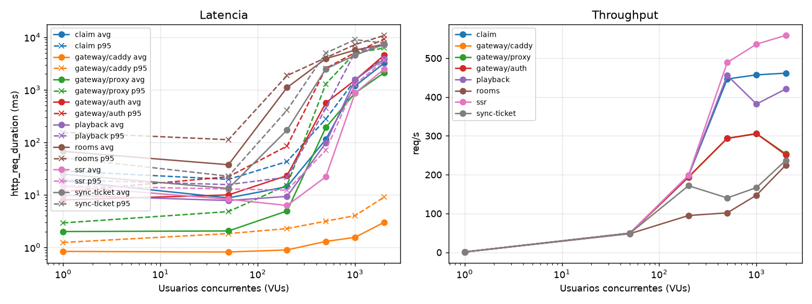

# Resultados del Laboratorio 6: rendimiento por usuarios concurrentes

Curva de rendimiento y knee de los endpoints más delicados de TINT, medidos con k6 por VUs a través del gateway. El método, la elección de endpoints y cómo reproducirlo están en [pruebas-rendimiento-lab6.md](pruebas-rendimiento-lab6.md).

| Campo | Valor |
| :--- | :--- |
| Fecha | 2026-11-16, de 22:45 a 23:53 (hora de Colombia) |
| Código | `develop` en `7362449`, más el banco de esta rama; imágenes construidas de ese commit |
| Máquina | **una sola máquina** para el stack y la carga: AMD Ryzen 3 2200G (4 núcleos), 13,5 GB de RAM, Linux 7.2, Docker 29.9.2 |
| Stack | proyecto de Compose aislado `tintlab6` (`bench/run.py --local`): gateway (Caddy), web (SSR Node), identity-api, PostgreSQL, Redis, MinIO y Firebase Auth Emulator; datos sintéticos |
| Carga | k6 v2.4.0 (imagen `grafana/k6:2.4.0`, red del host) contra `https://localhost:8443`; `ramping-vus` con niveles 1, 50, 200, 500, 1000 y 2000 VUs (rampa de 5 s y meseta medida de 30 s), `sleep(1)` por iteración |
| Corridas | 3 por endpoint principal (sync-ticket, playback, gateway y claim), cada una con el stack recreado (`down -v` y `up`); 1 para los opcionales (rooms y ssr). Las tablas muestran la **mediana por nivel** |
| Knee | último nivel antes del primero con fallos (`http_req_failed` > 0) o con p95 > 10 veces el p95 base (el menor de los niveles sanos) |
| Ruido | otro contenedor ajeno (`stats-mongo-test`) en reposo (0,33 % de CPU) |

Las 14 ejecuciones de k6 terminaron con código 0, y en los niveles sin degradación el 100 % de las respuestas fue 2xx.

## 1. Resumen

| Prueba | Knee (mediana) | Knee por corrida | Throughput máximo | Primer síntoma |
| :--- | ---: | :--- | ---: | :--- |
| **T1 `POST /rooms/:id/sync-ticket`** (principal) | **50 VUs** | 50, 50, 50 | **~170 req/s** | p95 de 410 ms a 200 VUs; 14 % de fallos a 1000 y 99,7 % a 2000 |
| T2 `GET /rooms/:id/playback` (invitado) | 200 VUs | 50, 200, 500 | ~455 req/s | p95 de 444 ms a 500 VUs; 16 % de fallos a 1000 |
| T3 gateway, Caddy solo (`/healthz`) | sin knee hasta 2000 | 2000, 2000, 2000 | (limitado por las otras capas) | p95 ≤ 9 ms incluso a 2000 VUs |
| T3 gateway, proxy sin auth (`/api/v1/healthz`) | 200 VUs | 200, 200, 200 | ~300 req/s | 0,36 % de fallos y p95 de 1,3 s a 500 VUs |
| T3 gateway, proxy + `forward_auth` (playback) | 200 VUs | 200, 200, 200 | ~300 req/s | 0,86 % de fallos y p95 de 2,5 s a 500 VUs; 46 % de fallos a 2000 |
| T4 `POST /invitations/claim` | 200 VUs | 200, 200, 200 | ~460 req/s | p95 de 277 ms a 500 VUs; fallos solo a 2000 (0,42 %) |
| `GET /rooms` (300 salas sembradas) | 50 VUs | 50 (1 corrida) | ~100 req/s | p95 de 1,9 s a 200 VUs; 54 % de fallos a 1000 |
| SSR `GET /invite/:code` (web) | 500 VUs | 500 (1 corrida) | ~560 req/s | p95 de 1,3 s a 1000 VUs; 33 % de fallos a 2000 |



## 2. Lectura

- **El cuello de botella del sistema es identity-api, no el gateway.**
  - Caddy, cuando responde por sí mismo, no se degrada en ningún nivel: su p95 va de 1,2 ms a 9 ms.
  - En la misma iteración, las rutas que cruzan a identity-api se degradan a partir de 500 VUs. Lo hacen tanto `/api/v1/healthz`, que no hace trabajo, como la ruta con `forward_auth`.
  - identity-api llega a **108-128 % de CPU** en todas las pruebas; en `docker stats`, 100 % es un núcleo. Eso coincide con un **único proceso Node** (`server.ts`) saturando su núcleo.
  - Como todo `/api/*` y `/ws/*` protegido pasa por `forward_auth` hacia identity-api, cuando este se satura se degradan también las peticiones a los demás microservicios.
- **sync-ticket es el endpoint más débil, como se esperaba.**
  - Tiene el knee más bajo, 50 VUs en las 3 corridas.
  - Su throughput se estanca en ~170 req/s, unas 2,7 veces menos que playback (~455) o claim (~460) en la misma máquina.
  - Es el que más CPU de Postgres gasta: máx. 82,5 %, frente a 34 % en playback.
  - Eso es consistente con su costo por petición: doble autenticación del host (gateway y ruta), 2 `INSERT … ON CONFLICT DO UPDATE` sobre la **misma fila** de `users`, 2 lecturas de `rooms` y una firma JWT.
  - Por ser la puerta de sync, social, voz y transmisión, que se pide en cada (re)conexión de WebSocket, su saturación bloquea la entrada a los canales en tiempo real.
  - A 2000 VUs falla el 99,7 %, con latencias medias de ~7 s, por encima del `response_header_timeout` de 5 s del gateway. Lo más probable es que sean los 503 que el gateway devuelve al agotarse ese tiempo; el export de k6 no desglosa los códigos de estado. El aumento de req/s a 2000 VUs viene de respuestas con error, no de más capacidad.
- **`GET /rooms` degrada antes que todos con datos realistas.** Con 300 salas por host se queda en ~100 req/s, y a 1000 VUs falla más de la mitad. Encaja con las consultas sin índice en `rooms.host_id` e `invitations.room_id` y con la lectura de todas las invitaciones para filtrarlas en JS.
- **claim aguanta mejor de lo esperado.** Escribe en cada petición, pero no autentica a un host (no hay Firebase ni upsert): sostiene ~460 req/s y casi no falla hasta 2000 VUs. Sin rate limit, sin embargo, una avalancha de 2000 invitados lleva el p95 a 4,3 s.
- **El SSR de la web es el componente más holgado** (knee en 500 VUs). A 2000 VUs llega a 110 % de CPU, también un solo proceso Node.

## 3. Variación entre corridas

p95 mínimo-máximo de las 3 corridas, por nivel:

| VUs | sync-ticket p95 (ms) | playback p95 (ms) | claim p95 (ms) |
| ---: | :--- | :--- | :--- |
| 1 | 30-55 | 11-20 | 23-30 |
| 50 | 18-50 | 11-27 | 14-28 |
| 200 | 404-1759 | 20-722 | 26-162 |
| 500 | 3854-6613 | 108-716 | 227-1168 |
| 1000 | 6453-9391 | 1394-5207 | 1482-2635 |
| 2000 | 6070-9636 | 6025-7128 | 4024-5004 |

Por debajo del knee la latencia es estable, con rangos de unas decenas de ms. Pasado el knee el rango se abre mucho: es la zona de saturación, donde la cola de peticiones domina.
- **sync-ticket, claim y gateway:** mismo knee en las 3 corridas.
- **playback:** su knee varió entre 50 y 500 VUs, así que su valor es menos firme que el de sync-ticket.

## 4. Detalle por prueba

### T1. `POST /api/v1/rooms/:id/sync-ticket` (principal)

Host único (`--hosts 1`, 3 salas): todos los VUs comparten la fila del host en `users`.

| VUs | avg (ms) | p95 (ms) | p99 (ms) | req/s | Peticiones | Fallos |
| ---: | ---: | ---: | ---: | ---: | ---: | ---: |
| 1 | 24.76 | 51.07 | 70.09 | 1.0 | 30 | 0.00% |
| 50 ← knee | 13.26 | 22.69 | 33.87 | 49.2 | 1476 | 0.00% |
| 200 ← degrada | 170.81 | 410.32 | 1808.30 | 171.7 | 5150 | 0.00% |
| 500 | 2490.78 | 4995.00 | 5162.01 | 140.2 | 4207 | 0.07% |
| 1000 | 4554.47 | 8991.10 | 9552.66 | 166.8 | 5005 | 14.37% |
| 2000 | 7319.67 | 7736.63 | 8084.23 | 237.0 | 7109 | 99.71% |

Knee: 50 VUs; primer nivel degradado: 200 (p95 410 ms > 10× el p95 base (23 ms)).

CPU de la máquina (stack + k6): media 68.6 %, máx 100.0 %.

| Contenedor | CPU media | CPU máx | Memoria máx |
| --- | ---: | ---: | ---: |
| tintlab6-gateway-1 | 20.1 % | 135.9 % | 451 MiB |
| tintlab6-identity-api-1 | 43.5 % | 114.9 % | 405 MiB |
| tintlab6-postgres-1 | 32.2 % | 82.5 % | 57 MiB |
| tintlab6-web-1 | 0.5 % | 7.4 % | 35 MiB |
| tintlab6-redis-1 | 1.3 % | 7.3 % | 16 MiB |

### T2. `GET /api/v1/rooms/:id/playback` (invitado)

| VUs | avg (ms) | p95 (ms) | p99 (ms) | req/s | Peticiones | Fallos |
| ---: | ---: | ---: | ---: | ---: | ---: | ---: |
| 1 | 9.87 | 19.37 | 22.17 | 1.0 | 30 | 0.00% |
| 50 | 7.81 | 15.67 | 22.01 | 49.5 | 1486 | 0.00% |
| 200 ← knee | 9.35 | 21.70 | 32.51 | 198.0 | 5941 | 0.00% |
| 500 ← degrada | 96.94 | 444.37 | 1152.48 | 455.7 | 13672 | 0.00% |
| 1000 | 1554.44 | 5166.29 | 5686.16 | 382.1 | 11464 | 15.99% |
| 2000 | 3888.51 | 7046.79 | 7945.58 | 420.8 | 12623 | 38.52% |

Knee: 200 VUs; primer nivel degradado: 500 (p95 444 ms > 10× el p95 base (16 ms)).

CPU de la máquina (stack + k6): media 67.7 %, máx 100.0 %.

| Contenedor | CPU media | CPU máx | Memoria máx |
| --- | ---: | ---: | ---: |
| tintlab6-identity-api-1 | 48.6 % | 116.5 % | 225 MiB |
| tintlab6-gateway-1 | 22.9 % | 74.6 % | 565 MiB |
| tintlab6-postgres-1 | 12.1 % | 33.6 % | 48 MiB |
| tintlab6-redis-1 | 2.9 % | 8.3 % | 18 MiB |
| tintlab6-web-1 | 0.4 % | 7.5 % | 38 MiB |

### T3. Gateway por capas

Cada iteración hace las 3 peticiones en orden, así que comparten la misma carga y el mismo req/s.

#### Caddy solo (`/healthz`)

| VUs | avg (ms) | p95 (ms) | p99 (ms) | req/s | Peticiones | Fallos |
| ---: | ---: | ---: | ---: | ---: | ---: | ---: |
| 1 | 0.84 | 1.24 | 1.98 | 1.0 | 30 | 0.00% |
| 50 | 0.82 | 1.83 | 3.13 | 49.3 | 1479 | 0.00% |
| 200 | 0.90 | 2.28 | 3.68 | 194.0 | 5819 | 0.00% |
| 500 | 1.30 | 3.15 | 5.23 | 293.7 | 8810 | 0.00% |
| 1000 | 1.55 | 4.03 | 7.70 | 305.7 | 9170 | 0.00% |
| 2000 ← knee | 3.02 | 9.12 | 24.97 | 253.3 | 7598 | 0.00% |

Knee: 2000 VUs; primer nivel degradado: - (sin degradación en los niveles medidos).

#### Proxy sin auth (`/api/v1/healthz` → identity-api)

| VUs | avg (ms) | p95 (ms) | p99 (ms) | req/s | Peticiones | Fallos |
| ---: | ---: | ---: | ---: | ---: | ---: | ---: |
| 1 | 2.01 | 2.93 | 3.74 | 1.0 | 30 | 0.00% |
| 50 | 2.06 | 4.81 | 7.14 | 49.3 | 1479 | 0.00% |
| 200 ← knee | 4.94 | 15.23 | 50.04 | 194.0 | 5819 | 0.00% |
| 500 ← degrada | 191.12 | 1289.27 | 3509.32 | 293.7 | 8810 | 0.36% |
| 1000 | 866.94 | 5004.94 | 5323.17 | 305.7 | 9170 | 12.04% |
| 2000 | 2124.40 | 6221.49 | 6843.75 | 253.3 | 7598 | 22.26% |

Knee: 200 VUs; primer nivel degradado: 500 (fallos 0.36%).

#### Proxy + `forward_auth` (playback de invitado)

| VUs | avg (ms) | p95 (ms) | p99 (ms) | req/s | Peticiones | Fallos |
| ---: | ---: | ---: | ---: | ---: | ---: | ---: |
| 1 | 8.03 | 11.56 | 16.41 | 1.0 | 30 | 0.00% |
| 50 | 9.98 | 22.10 | 35.25 | 49.3 | 1479 | 0.00% |
| 200 ← knee | 23.28 | 84.92 | 161.60 | 194.0 | 5819 | 0.00% |
| 500 ← degrada | 563.53 | 2543.71 | 4984.11 | 293.7 | 8810 | 0.86% |
| 1000 | 1523.97 | 5108.98 | 5879.60 | 305.7 | 9170 | 16.61% |
| 2000 | 4579.63 | 9289.39 | 10085.19 | 250.9 | 7528 | 45.87% |

Knee: 200 VUs; primer nivel degradado: 500 (fallos 0.86%).

CPU de la máquina (stack + k6): media 71.9 %, máx 100.0 %.

| Contenedor | CPU media | CPU máx | Memoria máx |
| --- | ---: | ---: | ---: |
| tintlab6-gateway-1 | 32.2 % | 140.2 % | 629 MiB |
| tintlab6-identity-api-1 | 47.0 % | 108.0 % | 189 MiB |
| tintlab6-postgres-1 | 9.1 % | 27.9 % | 43 MiB |
| tintlab6-redis-1 | 2.5 % | 8.1 % | 10 MiB |
| tintlab6-web-1 | 0.5 % | 7.2 % | 34 MiB |

### T4. `POST /api/v1/invitations/claim`

| VUs | avg (ms) | p95 (ms) | p99 (ms) | req/s | Peticiones | Fallos |
| ---: | ---: | ---: | ---: | ---: | ---: | ---: |
| 1 | 18.63 | 28.49 | 33.52 | 1.0 | 30 | 0.00% |
| 50 | 8.75 | 19.72 | 34.26 | 49.5 | 1486 | 0.00% |
| 200 ← knee | 14.30 | 43.03 | 85.48 | 197.1 | 5913 | 0.00% |
| 500 ← degrada | 113.37 | 276.79 | 354.76 | 446.5 | 13396 | 0.00% |
| 1000 | 1181.11 | 1523.57 | 1641.44 | 457.2 | 13717 | 0.00% |
| 2000 | 3229.42 | 4329.46 | 4944.77 | 461.5 | 13846 | 0.42% |

Knee: 200 VUs; primer nivel degradado: 500 (p95 277 ms > 10× el p95 base (20 ms)).

CPU de la máquina (stack + k6): media 71.6 %, máx 100.0 %.

| Contenedor | CPU media | CPU máx | Memoria máx |
| --- | ---: | ---: | ---: |
| tintlab6-identity-api-1 | 54.3 % | 119.1 % | 292 MiB |
| tintlab6-postgres-1 | 28.0 % | 68.2 % | 67 MiB |
| tintlab6-gateway-1 | 18.5 % | 66.3 % | 389 MiB |
| tintlab6-redis-1 | 3.2 % | 9.8 % | 22 MiB |
| tintlab6-web-1 | 0.4 % | 7.1 % | 33 MiB |

### Opcional: `GET /api/v1/rooms` (300 salas sembradas, 1 corrida)

| VUs | avg (ms) | p95 (ms) | p99 (ms) | req/s | Peticiones | Fallos |
| ---: | ---: | ---: | ---: | ---: | ---: | ---: |
| 1 | 67.36 | 154.82 | 185.66 | 1.0 | 29 | 0.00% |
| 50 ← knee | 37.48 | 112.28 | 358.72 | 48.2 | 1445 | 0.00% |
| 200 ← degrada | 1103.35 | 1865.01 | 2052.61 | 94.9 | 2847 | 0.00% |
| 500 | 3902.30 | 4062.21 | 4274.31 | 101.7 | 3052 | 0.00% |
| 1000 | 5684.50 | 7240.91 | 8539.54 | 147.3 | 4420 | 54.39% |
| 2000 | 7367.18 | 10841.98 | 11062.50 | 224.9 | 6746 | 67.82% |

Knee: 50 VUs; primer nivel degradado: 200 (p95 1865 ms > 10× el p95 base (112 ms)).

CPU de la máquina (stack + k6): media 56.8 %, máx 100.0 %.

| Contenedor | CPU media | CPU máx | Memoria máx |
| --- | ---: | ---: | ---: |
| tintlab6-identity-api-1 | 82.0 % | 128.4 % | 373 MiB |
| tintlab6-gateway-1 | 14.4 % | 55.6 % | 535 MiB |
| tintlab6-postgres-1 | 28.1 % | 47.0 % | 46 MiB |
| tintlab6-redis-1 | 1.4 % | 7.5 % | 18 MiB |
| tintlab6-web-1 | 0.4 % | 5.3 % | 31 MiB |

### Opcional: SSR `GET /invite/:code` (web, 1 corrida)

| VUs | avg (ms) | p95 (ms) | p99 (ms) | req/s | Peticiones | Fallos |
| ---: | ---: | ---: | ---: | ---: | ---: | ---: |
| 1 | 14.80 | 14.89 | 89.74 | 1.0 | 30 | 0.00% |
| 50 | 8.27 | 12.95 | 18.84 | 49.5 | 1484 | 0.00% |
| 200 | 6.29 | 12.31 | 22.37 | 198.7 | 5961 | 0.00% |
| 500 ← knee | 22.04 | 70.40 | 117.51 | 489.0 | 14669 | 0.00% |
| 1000 ← degrada | 862.28 | 1259.11 | 2348.79 | 536.3 | 16089 | 0.00% |
| 2000 | 2493.65 | 3651.64 | 4825.71 | 558.9 | 16766 | 33.45% |

Knee: 500 VUs; primer nivel degradado: 1000 (p95 1259 ms > 10× el p95 base (12 ms)).

CPU de la máquina (stack + k6): media 58.1 %, máx 97.8 %.

| Contenedor | CPU media | CPU máx | Memoria máx |
| --- | ---: | ---: | ---: |
| tintlab6-web-1 | 51.7 % | 110.6 % | 392 MiB |
| tintlab6-identity-api-1 | 47.8 % | 107.5 % | 234 MiB |
| tintlab6-gateway-1 | 22.0 % | 56.6 % | 343 MiB |
| tintlab6-postgres-1 | 22.0 % | 48.3 % | 44 MiB |
| tintlab6-redis-1 | 1.3 % | 7.8 % | 9 MiB |

## 5. Limitaciones

- **Generador y stack en la misma máquina.** El laboratorio pide un nodo independiente. Aquí k6 y el stack compartieron 4 núcleos, y la CPU total llegó al 100 % en los niveles altos de todas las pruebas. Los knees absolutos son, por tanto, **más bajos** que en un servidor dedicado (la línea base, con generador aparte y 12 CPU, sostuvo ~400 req/s con mezcla de endpoints). Lo comparable entre pruebas es el **orden relativo**: sync-ticket y rooms degradan primero, Caddy nunca. La corrida con dos máquinas es `python3 bench/run.py lab6 --label lab6` (sin `--local`).
- **Tokens del emulador.** Los tokens de host son `alg: none` del Firebase Auth Emulator, sin la verificación RS256 de producción, así que en producción sync-ticket y rooms cuestan más.
- **Contención de la fila de `users`.** No se midió directamente (no hubo muestreo de `pg_stat_activity`). La relación con el knee de sync-ticket es una inferencia a partir del costo por petición y de la CPU de Postgres.
- **Modelo cerrado.** Con `sleep(1)`, cuando el sistema se vuelve lento baja el req/s ofrecido. Por eso se reportan juntos req/s y latencia por nivel.
- **Datos crudos sin versionar.** Los JSON de k6, los CSV de `docker stats` y la CPU por corrida quedan en `bench/results/lab6-local/`, que no se versiona. Este documento reproduce los valores que sustentan las conclusiones.

## 6. Cómo se reprodujo

```bash
make up    # o docker compose up -d --build gateway web identity-api postgres redis minio minio-init firebase-auth-emulator
for s in web identity-api firebase-auth-emulator; do docker tag "tint-${s}:latest" "tint-monorepo-${s}:latest"; done
python3 bench/run.py --local --ip 127.0.0.1 lab6 --label lab6-local --runs 3
python3 bench/run.py --local --ip 127.0.0.1 lab6 --label lab6-local --runs 1 --targets rooms,ssr
python3 bench/summarize.py --lab6 bench/results/lab6-local
```
